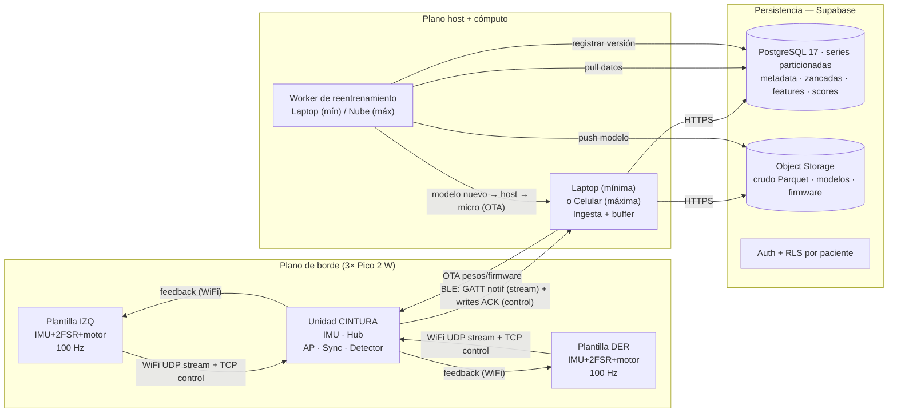

# Arquitectura Informática
## Sistema de plantillas inteligentes bilaterales para detección personalizada de anomalías de marcha post-ACV

**Proyecto:** TESIS — Detección de anomalías de marcha en pacientes post-ACV con plantillas bilaterales, feedback vibrotáctil e inferencia en el borde.
**Versión del documento:** 1.0 (borrador para revisión)
**Autores:** Tobías Azcueta Busco · Juan Bautista Gramaglia
**Fecha:** julio 2026

---

## 0. Estructura de la documentación (vistas)

Esta arquitectura se documenta en **cuatro vistas** a distinto nivel de abstracción, más una capa transversal de tecnología. Este documento maestro funciona como **índice y overview**: da la foto completa del sistema en una lectura, mantiene lo genuinamente transversal (alcance, evolución mínima→máxima, riesgos, mapa de entidades) y **apunta a las vistas, donde vive el detalle**. No duplica el contenido de las vistas ni el índice de la bitácora (**ADR-039**).

| Vista | Contenido | Archivo |
|---|---|---|
| **1 — Sistema** | Nodos, topología, transporte, sync (alto nivel), modos, evolución | `vistas/1_vista_sistema.md` |
| **2 — Dispositivo / Firmware** | Adquisición, eventos, módulo de features (ejecución), inferencia on-device, feedback, OTA | `vistas/2_vista_firmware.md` |
| **3 — Datos y ML** | Catálogo/definición de features, taxonomía de modelos, calibración/baseline, ciclo de vida | `vistas/3_vista_datos_ml.md` |
| **4 — Backend y aplicación** | Supabase, worker, app host, dashboard clínico, seguridad | `vistas/4_vista_backend_app.md` |
| **Transversal — Stack** | Librerías/módulos por componente | `stack_tecnologico.md` |

**Regla de layering:** cada algoritmo/feature se **define una vez en la Vista 3** (fórmula, parámetros, versionado) y se **ejecuta en la Vista 2** (firmware) y en el worker.

> **Dónde vive qué.** Las **cuatro vistas** son la fuente canónica de su dominio. El **esquema ejecutable** de la base es `src/db/schema.sql` (ADR-037). El **qué y el porqué de cada decisión** están en `../decisiones/bitacora_decisiones.md`, que tiene su propio índice. Lo que queda abierto, en `../cuestiones_pendientes.md`. Este documento **no mantiene una segunda copia de nada de eso**: si una sección de acá y una vista discrepan, **manda la vista**.

---

## 1. Resumen ejecutivo

El sistema captura la marcha de un paciente mediante **dos plantillas instrumentadas** (una por pie) y **una unidad de cintura**, calcula descriptores biomecánicos (features) y detecta desviaciones respecto de la marcha "normal" personalizada del propio paciente, entregando **feedback vibrotáctil en tiempo real**. La filosofía de diseño es **personalización primero** (un baseline por paciente, no un modelo poblacional) y explotar la **simetría inter-miembro** que habilita la configuración bilateral.

La arquitectura se define en **dos horizontes**: un **objetivo de mínima** (entorno controlado, con una laptop cerca, orientado a capturar dataset y entrenar/evaluar algoritmos) y un **objetivo de máxima** (uso diario continuo, con un celular reemplazando a la laptop y un backend de reentrenamiento en la nube). Todo lo que se construye para la mínima está diseñado para **escalar sin reescrituras estructurales** hacia la máxima; los puntos donde la mínima y la máxima difieren están explícitamente aislados detrás de interfaces.

Este documento fija las decisiones de arquitectura, su justificación, y el detalle de implementación (topología, protocolos, sincronización, pipeline de datos, modelos, ciclo de vida, base de datos y seguridad). El **roadmap de implementación** se aborda en un documento aparte, una vez validada esta arquitectura.

---

## 2. Alcance

### 2.1 Objetivo de mínima

Que **toda la infraestructura funcione en un entorno controlado**, con una computadora (laptop) cerca capaz de captar los datos, almacenarlos y reentrenar los algoritmos. Concretamente:

- Las dos plantillas envían sus datos a la unidad de cintura.
- La cintura recibe ambos flujos **simultáneamente**, preservando la marca temporal de cada uno (o garantizando que lo recibido es inmediato de cada plantilla).
- La cintura reenvía los datos a la laptop.
- La laptop almacena los datos en una **base de datos remota** (no localmente) organizados por paciente.
- Sobre esos datos se **evalúan distintos algoritmos de forma asincrónica** (fase de entrenamiento y evaluación).
- Los algoritmos entrenados se **despliegan al micro** para correr localmente; los pesos/modelos también se **respaldan en la base de datos**.

### 2.2 Objetivo de máxima

Migrar la infraestructura de "entorno controlado con computadora cerca" a **uso diario continuo**:

- La laptop se reemplaza por un **celular**; la cintura se comunica con el celular por **Bluetooth (BLE)**.
- Persiste el guardado por paciente en la base de datos remota y el respaldo de modelos.
- El reentrenamiento de los algoritmos que "necesitan una computadora" corre en un **backend en la nube** (worker), no en el celular; el celular actúa como puente hacia el micro y hacia la nube.

### 2.3 Principio rector

**La infraestructura del lado del micro es la misma mande a una laptop o a un celular.** El micro es un periférico BLE (servidor GATT) agnóstico al tipo de central que se conecta. Lo único que cambia entre mínima y máxima es el **cliente** (app de laptop vs. app móvil) y la ubicación del **worker de reentrenamiento** (laptop vs. nube). Esto se garantiza con **interfaces de transporte y de despliegue** que aíslan esos puntos de variación.

---

## 3. Hardware

Tres nodos, todos **Raspberry Pi Pico 2 W** (RP2350, Cortex-M33 @150 MHz, 520 KB SRAM, WiFi+BLE CYW43439), muestreando a **100 Hz**:

- **Dos plantillas** (una por pie): IMU **MPU-6050** + **2 FSR** (punta y talón; el 3º/4º medial-lateral en la próxima revisión del PCB, con mux analógico — ADR-023 / ADR-041) + **motor vibrador** PWM.
- **Una unidad de cintura**: IMU MPU-6050 a la altura de ~L4-L5. Es el **hub**: AP WiFi, maestro de sincronización, fusión bilateral, detección y uplink BLE.

**Consideración de radio:** el CYW43439 es un chip único WiFi+BLE con **una sola antena** en 2,4 GHz. La cintura debe sostener **WiFi-AP + BLE simultáneos** por **coexistencia** (time-division). Es un requisito permanente de la máxima y se asume desde la mínima (**§15**, Riesgos).

> **Detalle** (tabla de nodos, canales por pie, pinout de referencia): **Vista 1 §1**. Estado del PCB y checklist de la próxima revisión: `esquema_alimentacion.md`.

---

## 4. Vista general

El sistema se organiza en cuatro planos:

1. **Plano de sensado y borde** (los 3 micros): adquisición a 100 Hz, sincronización, detección de eventos, cálculo de features (en captura operativa y en edge), inferencia local (clases L/E) y feedback vibrotáctil.
2. **Plano de transporte:** WiFi (plantillas↔cintura) y BLE (cintura↔host), cada uno con un **canal rápido-tolerante** (stream) y un **canal confiable** (control/modelos).
3. **Plano de host y cómputo:** laptop (mínima) o celular + worker en la nube (máxima). Ingesta, entrenamiento pesado, orquestación.
4. **Plano de persistencia:** Supabase (Postgres 17 con series particionadas + object storage + auth — ADR-044), que actúa como **sistema de registro** de datos, features, scores y modelos.

> Diagrama fuente: `diagrama_arquitectura.mermaid`. Otros diagramas: `esquema_base_de_datos`, `ciclo_de_vida_modelos`, `adquisicion_dma_irq`, `calibracion_baseline`, `componentes_backend_app`, `esquema_alimentacion`.

---

## 5. Topología y transporte

**Plantillas ↔ cintura: WiFi, cintura como Access Point** [ADR-001]. Estrella de un solo salto, sin infraestructura externa, con la fusión donde los datos ya convergen. Enlace permanente: no cambia entre mínima y máxima.

**Cintura ↔ host: BLE desde la mínima** [ADR-002]. La cintura expone un servidor GATT; el host (laptop o celular) es el central. Se adopta BLE desde el inicio porque el firmware de la cintura queda **idéntico** en ambos horizontes, se enfrenta **temprano** el riesgo de coexistencia, y el caudal (~5 KB/s) sobra.

**Modelo de conectividad tipo auriculares** [ADR-028]. Los micros **nunca se conectan a WiFi de internet**: el único WiFi es el enlace privado plantillas↔cintura. El host tiene internet y empuja a Supabase; el OTA va por BLE. Sin provisioning de redes. Pairing cintura↔host sin botón: gesto de sacudida + passkey fijo + bond list multi-host.

**Dos canales por enlace** [ADR-003]: rápido-tolerante para el stream (**UDP** / notificaciones GATT) + confiable para control y modelos (**TCP** / writes con ACK). A 100 Hz, perder una muestra es irrelevante; el *head-of-line blocking* de TCP no lo es.

> **Detalle** (justificaciones, restricciones del celular, formato de paquete): **Vista 1 §3 y §4**.

---

## 6. Sincronización temporal

La simetría inter-miembro —el diferencial clínico del sistema— exige relacionar ambos pies sobre una **misma línea de tiempo a nivel de muestra**. El mecanismo es un **backbone de reloj en la capa de aplicación** (portable WiFi↔BLE): timestamp + nº de secuencia por muestra, **beacon** periódico emitido por la cintura, y **corrección de drift** por regresión lineal (offset + skew) [ADR-004].

**El backbone es el único mecanismo de sincronización.** El emparejado de zancadas por evento **IC** usa el reloj **ya sincronizado** para asociar la zancada izquierda con la derecha: no sincroniza relojes ni compensa drift, y **no es un fallback** si el backbone falla. Un IC anómalo es *señal de anomalía* y se mide como feature; usarlo como marca temporal no entra en conflicto con eso.

> **Detalle** (mecanismo completo, aclaración conceptual): **Vista 1 §5**. **Implementación** (beacon en firmware, regresión de drift): **Vista 2 §4**.

---

## 7. Pipeline de datos y cómputo

**Cómputo distribuido** [ADR-005]: cada **plantilla** calcula sus **features por-pie** y detecta sus eventos **IC/TO/MS**; la **cintura** hace la **fusión bilateral** (simetría, double support), calcula las features de tronco, corre el detector y decide el feedback. Definición de features **única y compartida**, versionada por `feature_set_version`.

**Tres fases de operación** [ADR-005 rev c]:

| Fase | Qué sube | Para qué |
|---|---|---|
| **Exploratoria** | Crudo continuo, **sin features del micro** | Ingeniería y selección de features, barrido de ventanas y algoritmos → congela un `feature_set_version` |
| **Operativa** (incluye calibración/baseline) | **Features del micro + crudo** | Entrenar *skew-free* (ADR-018) y validar paridad C↔Python sobre ese set nuevo |
| **Edge** (uso real) | Features + eventos + scores en vivo; **crudo sólo por snippet ante anomalía** | Operación |

**Adquisición determinística a 100 Hz** [ADR-014 / ADR-026]: ADC disparado por hardware + DMA con sobremuestreo ~1 kHz y decimación ×10 (que además mejora el SNR del FSR); IMU leído en el **tick maestro por DMA** (un timestamp por tupla FSR+IMU). Todo interno al RP2350, sin componentes extra en el PCB.

**Feedback vibrotáctil** [ADR-027 / SPEC-09]: el detector corre en la cintura y el motor está en la plantilla, así que el enlace es **bidireccional**. Es **monitoreo y alerta, no corrección**: score designado sobre una **ventana de zancadas** → anomalía sostenida → 3 bandas per-paciente → alerta escasa.

> **Detalle:** definición de features y algoritmos → **Vista 3**; ejecución en firmware (adquisición, eventos, cores, inferencia, OTA) → **Vista 2** y `vistas/2_specs_algoritmos_firmware.md`.

---

## 8. Modelos y Machine Learning

La arquitectura es **agnóstica al modelo**: cada modelo declara su **clase** en el registry y el runtime rutea inferencia y reentrenamiento según esa declaración [ADR-011 rev].

| Clase | Infiere | Reentrena |
|---|---|---|
| **L** — Local-Local | Cintura | **Cintura**, dato a dato |
| **E** — Edge + Worker | Cintura | **Worker** |
| **H** — Host | **Host** (celular/laptop), tiempo real | **Worker** |
| **W** — Worker-only | **Worker**, batch/offline | **Worker** |

**Invariante:** la inferencia en tiempo real corre en **`hub`** (preferido) o en **`host`** (si el modelo no entra), **nunca en el worker/nube** [ADR-013]. Pasar de `hub` a `host` es un **switch de config** (`inference_target`), sin reescritura, porque el decisor de feedback es agnóstico al origen del score y el host aloja un runtime espejo.

**Mahalanobis cumple doble función:** detector en vivo de clase L (<100 µs, primero a implementar) **y sensor de drift** que dispara el reentrenamiento de las clases E/H/W.

**Personalización primero:** el baseline es por paciente, definido en una sesión de calibración (~100 zancadas). La evidencia lo sostiene: one-class personalizado AUC≈0,97 vs ~55 % de un modelo global.

> **Detalle** (catálogo de features, tabla de algoritmos, estrategia progresiva de evaluación, calibración): **Vista 3** y `vistas/3_analisis_features_y_algoritmos.md`.

---

## 9. Ciclo de vida de modelos y OTA

**Dónde entrena:** clase **L en el micro** (nunca toca el worker); clases **E/H/W en el worker** — laptop en la mínima, nube en la máxima. **Supabase no entrena**: es el sistema de registro (sus Edge Functions sólo disparan jobs).

**Disparo:** por **drift** (Mahalanobis), por **schedule** o **manual**; queda registrado en `retrain_jobs`.

**Despliegue OTA A/B desde el inicio** [ADR-012], por BLE desde el host: pesos (artefacto del modelo a un slot de flash, con checksum y conmutación atómica) y **firmware completo** (bootloader A/B con reversión si la imagen nueva no reporta OK). El riesgo de brickeo se mitiga con A/B + checksum + watchdog + modo de recuperación.

**Versionado y respaldo:** los modelos **E/H/W** quedan en la DB (fila en `models` + artefacto en storage) con versión, métricas y linaje, y la anterior se conserva como *last-known-good*. Los de clase **L** no viajan por OTA: su estado adaptado sube en el **check-in** de cada sesión y se versiona igual. **La DB es la fuente de verdad** y el flash del micro una copia de trabajo que se reescribe en cada provisioning [ADR-043 rev]. > **Detalle:** Vista 4 §4.1.

> **Detalle:** mecánica de firmware → **Vista 2 §8**; lado backend y registry → **Vista 4 §6**; ciclo conceptual → **Vista 3 §6** y `ciclo_de_vida_modelos.mermaid`.

---

## 10. Persistencia y backend

**Supabase** como plataforma gestionada [ADR-006/007]: **Postgres 17** + **object storage** para blobs + auth. Modelo en tres capas: relacional para metadata, **tablas particionadas por mes de inicio de sesión** para zancadas/eventos/features/scores (particionado nativo + `pg_partman` — ADR-044), object storage para crudo (Parquet), artefactos de modelos e imágenes de firmware. La **zancada es una entidad** numerada en el borde, con FK reales e ingesta idempotente (ADR-046); el esquema cambia sólo por **migraciones versionadas** que aplica CI (ADR-045), y nada se expone por la Data API sin grant explícito (ADR-047).

**Retención tiered por fase** [ADR-008] *(volumen y supuestos: Vista 4 §1.4)*: en fase de dataset se guarda **crudo completo** (máxima trazabilidad); en uso real se guardan features/eventos/scores y el **crudo sólo alrededor de anomalías** — evita del orden de **6,7 GB/mes/paciente** (~8 h/día, sin comprimir — supuestos en Vista 4 §1.4) conservando lo clínicamente interesante.

**Worker de reentrenamiento** [ADR-009]: separado de Supabase. Laptop en la mínima, nube en la máxima (proveedor concreto → **CP-06**). Entrena E/H/W, cuantiza a int8 y publica al registry; corre con `service_role`.

**App host y UI de control** [ADR-033]: el host es puente (ingesta BLE, buffer local, escritura a Supabase, puente OTA, runtime espejo para clase H) **y** sede de la UI de control — app local en Python (`bleak` + FastAPI) en la mínima, app móvil en la máxima. El **dashboard clínico** es de solo-lectura y está **diferido a la máxima**.

> **Detalle** (tablas, `feature_vectors` en jsonb, trazabilidad de sesión, dashboard): **Vista 4**. **Esquema:** migraciones en `src/db/supabase/migrations/` y snapshot para leer en `src/db/schema.sql` (ADR-045, revisa ADR-037); el mapa de entidades está en **§11**.

---

## 11. Esquema — entidades

> **El esquema se define por migraciones** (`src/db/supabase/migrations/`) y se lee en el snapshot **`src/db/schema.sql`** (**ADR-045**, revisa ADR-037); antes de crear la base, `schema.sql` es el diseño. Esta sección mantiene el mapa de entidades; el detalle de columnas, índices y políticas RLS **no se duplica acá**. Definición canónica del backend: **Vista 4**. Diagrama ER: `esquema_base_de_datos.mermaid`.

| Capa | Tabla | Qué guarda |
|---|---|---|
| Metadata | `patients` | Paciente con `external_code` anónimo + PII mínima (año de nacimiento, sexo, lado afectado) |
| Metadata | `devices` | Cada micro: rol (`insole_left`/`insole_right`/`waist`), revisión de HW, versión de firmware |
| Metadata | `sessions` | Sesión de captura: paciente, **fase** (`exploratory`/`operational`/`edge` — ADR-005 rev c), `feature_set_version`, entorno, set de dispositivos, `host_type` (sólo trazabilidad — ADR-034) |
| Seguridad | `patient_access` | Pertenencia `user → patient → rol`; es la base de las políticas RLS (ADR-032) |
| Blobs | `raw_blobs` | Crudo continuo en Parquet (referencia a object storage) |
| Blobs | `anomaly_raw_snippets` | Crudo puntual retenido ante anomalía (modo edge) |
| Series | `strides` | **Una fila por zancada y por pie**, identificada por el `stride_seq` que asigna la plantilla: la unidad del sistema (ADR-046) |
| Series | `gait_events` | Eventos **IC/TO/MS** de cada zancada, con confianza y `flags` |
| Series | `feature_vectors` | Un vector de features por zancada (por pie) o por ciclo bilateral (`cycle_seq`), en `jsonb` + `feature_set_version` + **`features_source`** (`device`/`offline` — ADR-036) |
| Series | `anomaly_scores` | Score por unidad evaluada y por modelo, umbral, flag de anomalía y métrica de drift |
| Registry | `models` | Clase L/E/H/W, `inference_target`, `retrain_target`, versión, linaje, métricas, artefacto |
| Registry | `model_deployments` | Qué modelo corre en qué micro; `active` / `rolled_back` |
| Registry | `firmware_images` | Imágenes de firmware para el OTA A/B |
| Registry | `retrain_jobs` | Orquestación del reentrenamiento (`drift` / `schedule` / `manual`) |
| Config | `feedback_config` | Política de feedback vibrotáctil per-paciente: `feedback_source`, bandas T1/T2/T3, N de ventana, intensidad, refractario, histéresis (ADR-027 / SPEC-09) |

**Decisiones de esquema ya reflejadas en el DDL:** `feature_vectors.features` como **`jsonb`** (ADR-031) · **RLS estricto** por paciente vía `patient_access`, con `service_role` para el worker (ADR-032) · `sessions.host_type` (ADR-034) · **fase de captura de tres valores + origen de las features por fila** (ADR-036) · `gait_events.type ∈ {IC,TO,MS}` (ADR-038) · **series particionadas por mes de inicio de sesión** (ADR-044) · **migraciones + snapshot** (ADR-045) · **zancada como entidad, FK reales e ingesta idempotente** (ADR-046) · **grants explícitos y RLS en todas las tablas** (ADR-047).

**Pendiente:** las **columnas generadas `STORED`** e índices de expresión sobre las features calientes del dashboard (ADR-031) no se pueden fijar hasta congelar el `feature_set_version` y saber qué grafica el dashboard (**CP-20**).

---

## 12. Seguridad y privacidad

Se tratan **datos de salud**, con postura de defensa en capas. El aislamiento se resuelve con **RLS estricto por paciente** [ADR-032]: Row-Level Security en todas las tablas con `patient_id`, filtrando por la tabla de pertenencia `patient_access` (`user_id`, `patient_id`, `role`). La base misma filtra las filas — la app no puede pedir de más. El **worker corre con `service_role`**, que saltea RLS por diseño (backend seguro, nunca en el cliente). Ninguna tabla se expone por la Data API sin **grant explícito**, `anon` no tiene acceso a nada, la RLS cubre **todas** las tablas expuestas y las particiones quedan cerradas; una suite pgTAP lo verifica en CI [ADR-047].

Cifrado **en tránsito** (WPA2 en el enlace privado, BLE LE Secure Connections, HTTPS/TLS hacia Supabase) y **en reposo** (gestionado por la plataforma; artefactos validados por checksum). **Minimización:** `external_code` anónimo en lugar de PII directa. Al **reasignar** la cintura a otro paciente hay que borrar bonds + datos.

En la mínima hay un solo usuario (el investigador, rol `owner`); la máxima suma filas `clinician`/`patient` **sin cambiar el esquema**.

> **Nivel formal pendiente (CP-18):** consentimiento informado, alcance de la anonimización, auditoría de accesos y ratificación del nivel de pairing dependen del **comité de ética**. El diseño técnico ya está; falta el requisito externo.
>
> **Detalle:** **Vista 4 §2**.

---

## 13. Evolución mínima → máxima

Los únicos puntos de variación son la **app del host** (laptop → celular) y la **ubicación del worker** (laptop → nube). Todo lo demás —enlace plantillas↔cintura, sincronización, uplink BLE, base de datos, OTA— **no cambia**; los dos puntos de variación están aislados detrás de las interfaces de transporte y de despliegue, así que la migración no toca el borde ni la persistencia.

**El switch no existe en el micro** [ADR-034]: el firmware es **idéntico** en ambos horizontes y **agnóstico al tipo de central**. El flujo lo determina el host; el **modo** de operación es un **comando explícito** por el canal de control, nunca una inferencia. El host declara su tipo en `sessions.host_type` sólo para trazabilidad.

> **Detalle** (tabla componente por componente): **Vista 1 §7**.

---

## 14. Decisiones

Todas las decisiones de arquitectura, con sus opciones evaluadas y su justificación, viven en **`docs/decisiones/bitacora_decisiones.md`**, que tiene su propio **índice al inicio** (ADR-000 en adelante, con tema, decisión y estado).

**Este documento ya no mantiene una segunda lista de decisiones.** La tabla "Resumen de decisiones" que ocupaba esta sección duplicaba ese índice y se desactualizó: quedó detenida en ADR-028 mientras la bitácora seguía creciendo, y esa clase de duplicación fue el origen de la mayoría de las incoherencias detectadas en la auditoría del 2026-08-18 (**ADR-039**). Vale la misma regla que para el esquema de la base (ADR-037): **una sola fuente, varios consumidores.**

Para saber *qué* se decidió: el índice de la bitácora. Para saber *por qué*: el ADR correspondiente. Para saber *cómo funciona el sistema*: este documento y las cuatro vistas.

---

## 15. Riesgos y mitigaciones

| Riesgo | Impacto | Mitigación |
|---|---|---|
| Coexistencia WiFi-AP + BLE en el CYW43439 | Paquetes caídos / desconexiones en la cintura | Enfrentarla desde la mínima; tuning de intervalos; priorización; pruebas de carga tempranas |
| Precisión de sincronización insuficiente | Errores en features bilaterales | Backbone con beacon + corrección de drift; **validación empírica de la precisión** contra una referencia común; subir la cadencia del beacon si hace falta. *(El emparejado por IC **no** es fallback: usa el reloj ya sincronizado y no compensa drift — ADR-004.)* |
| Detección de IC poco fiable en marcha muy patológica | Segmentación/emparejado ruidoso | Detección por umbral de FSR (robusta), degradación a reloj solo, IC como refinamiento no crítico |
| ML on-device excede recursos del RP2350 | Inferencia lenta / no cabe | Cuantización int8 (TFLite Micro); si un modelo no entra, pasa a **clase H (host)** por config (`inference_target`), con runtime espejo. **Nunca al worker para tiempo real** (ADR-011 rev / ADR-013); la clase W queda para análisis offline |
| Brickeo por OTA de firmware | Dispositivo inutilizable | Bootloader A/B, checksum, watchdog, modo recuperación, last-known-good |
| Crecimiento de crudo en uso diario | Costo de almacenamiento | Retención tiered + crudo sólo por anomalía |
| Train/serve skew (features PC vs micro) | Modelo degradado en producción | Tests de paridad C↔Python en CI + entrenar con features del micro (ADR-018) |
| Datos de salud | Privacidad/compliance | Cifrado en tránsito/reposo, **RLS estricto** por paciente vía `patient_access` (ADR-032), anonimización, consentimiento (nivel formal → CP-18) |
| **Port de `pico-tflmicro` a RP2350 no mergeado** | Cae el runtime de inferencia elegido (SPEC-08) y parte del pipeline de ADR-022 | Validación de banco **temprana** (compilar el fork y correr un modelo int8 de juguete, sin depender del firmware del proyecto); **fallback documentado: CMSIS-NN directo** (ADR-020, opción C) — viable porque el AE denso es chico. **CP-21** |
| Cambio de esquema con datos ya capturados | Pérdida o corrupción de datos de pacientes | **Migraciones versionadas** que CI prueba sobre una base efímera antes de aplicarlas; una migración aplicada no se edita y la base remota no se toca a mano (ADR-045) |
| Exposición de datos por la Data API (tablas o particiones sin RLS) | Fuga de datos de salud | **Grants explícitos**, RLS en todas las tablas, particiones cerradas y tests pgTAP en CI (ADR-047) |

---

## 16. Cuestiones abiertas

Se llevan en un **registro vivo aparte**, que es la única fuente de verdad: **`docs/cuestiones_pendientes.md`**. Ahí se agregan las cuestiones al detectarlas y se mueven a *Resueltas* con su ADR. Este documento **no** duplica el estado — sólo apunta.

**No se copia la lista acá:** la última vez que se hizo quedó desactualizada (decía "7 abiertas" y contaba como abierta a CP-08, resuelta al día siguiente). La que amerita alerta es **CP-21** (port de `pico-tflmicro` a RP2350 — ver §15), la única que puede voltear una decisión ya tomada.

---

*Próximo paso (documento aparte): roadmap de implementación por fases para alcanzar esta arquitectura.*
