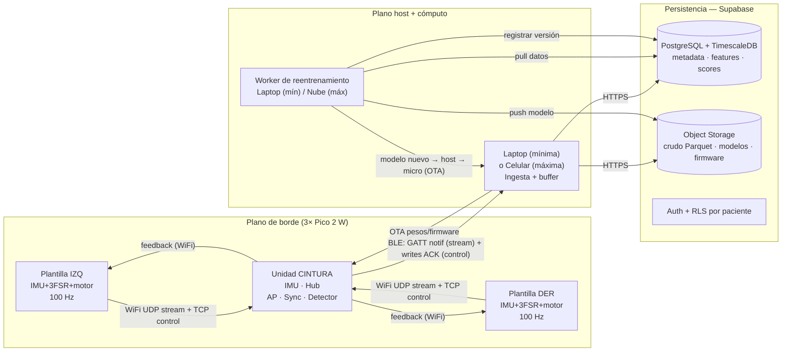

# Arquitectura Informática
## Sistema de plantillas inteligentes bilaterales para detección personalizada de anomalías de marcha post-ACV

**Proyecto:** TESIS — Detección de anomalías de marcha en pacientes post-ACV con plantillas bilaterales, feedback vibrotáctil e inferencia en el borde.
**Versión del documento:** 1.0 (borrador para revisión)
**Autores:** Tobías Azcueta Busco · Juan Bautista Gramaglia
**Fecha:** julio 2026

---

## 0. Estructura de la documentación (vistas)

Esta arquitectura se documenta en **cuatro vistas** a distinto nivel de abstracción, más una capa transversal de tecnología. Este documento maestro funciona como **índice y overview**: mantiene lo transversal (objetivos, resumen, objetivos de rendimiento, seguridad, evolución mínima→máxima, resumen de decisiones) y enlaza las vistas, donde vive el detalle.

| Vista | Contenido | Archivo |
|---|---|---|
| **1 — Sistema** | Nodos, topología, transporte, sync (alto nivel), modos, evolución | `vistas/1_vista_sistema.md` |
| **2 — Dispositivo / Firmware** | Adquisición, eventos, módulo de features (ejecución), inferencia on-device, feedback, OTA | `vistas/2_vista_firmware.md` |
| **3 — Datos y ML** | Catálogo/definición de features, taxonomía de modelos, calibración/baseline, ciclo de vida | `vistas/3_vista_datos_ml.md` |
| **4 — Backend y aplicación** | Supabase, worker, app host, dashboard clínico, seguridad | `vistas/4_vista_backend_app.md` |
| **Transversal — Stack** | Librerías/módulos por componente | `stack_tecnologico.md` |

**Regla de layering:** cada algoritmo/feature se **define una vez en la Vista 3** (fórmula, parámetros, versionado) y se **ejecuta en la Vista 2** (firmware) y en el worker.

> **Nota:** la migración del contenido detallado desde las secciones §1–§17 de abajo hacia las vistas es **incremental**; hasta completarse, esas secciones siguen siendo la fuente, y cada vista indica qué sección del maestro le corresponde.

---

## 1. Resumen ejecutivo

El sistema captura la marcha de un paciente mediante **dos plantillas instrumentadas** (una por pie) y **una unidad de cintura**, calcula descriptores biomecánicos (features) y detecta desviaciones respecto de la marcha "normal" personalizada del propio paciente, entregando **feedback vibrotáctil en tiempo real**. La filosofía de diseño es **personalización primero** (un baseline por paciente, no un modelo poblacional) y explotar la **simetría inter-miembro** que habilita la configuración bilateral.

La arquitectura se define en **dos horizontes**: un **objetivo de mínima** (entorno controlado, con una laptop cerca, orientado a capturar dataset y entrenar/evaluar algoritmos) y un **objetivo de máxima** (uso diario continuo, con un celular reemplazando a la laptop y un backend de reentrenamiento en la nube). Todo lo que se construye para la mínima está diseñado para **escalar sin reescrituras estructurales** hacia la máxima; los puntos donde la mínima y la máxima difieren están explícitamente aislados detrás de interfaces.

Este documento fija las decisiones de arquitectura, su justificación, y el detalle de implementación (topología, protocolos, sincronización, pipeline de datos, modelos, ciclo de vida, base de datos y seguridad). El **roadmap de implementación** se aborda en un documento aparte, una vez validada esta arquitectura.

---

## 2. Alcance

### 2.1 Objetivo de mínima

Que **toda la infraestructura funcione en un entorno controlado**, con una computadora (laptop) cerca capaz de captar los datos, almacenarlos y reentrenar los algoritmos. Concretamente:

- Las dos plantillas envían sus datos a la unidad de cintura.
- La cintura recibe ambos flujos **simultáneamente**, preservando la marca temporal de cada uno (o garantizando que lo recibido es inmediato de cada plantilla).
- La cintura reenvía los datos a la laptop.
- La laptop almacena los datos en una **base de datos remota** (no localmente) organizados por paciente.
- Sobre esos datos se **evalúan distintos algoritmos de forma asincrónica** (fase de entrenamiento y evaluación).
- Los algoritmos entrenados se **despliegan al micro** para correr localmente; los pesos/modelos también se **respaldan en la base de datos**.

### 2.2 Objetivo de máxima

Migrar la infraestructura de "entorno controlado con computadora cerca" a **uso diario continuo**:

- La laptop se reemplaza por un **celular**; la cintura se comunica con el celular por **Bluetooth (BLE)**.
- Persiste el guardado por paciente en la base de datos remota y el respaldo de modelos.
- El reentrenamiento de los algoritmos que "necesitan una computadora" corre en un **backend en la nube** (worker), no en el celular; el celular actúa como puente hacia el micro y hacia la nube.

### 2.3 Principio rector

**La infraestructura del lado del micro es la misma mande a una laptop o a un celular.** El micro es un periférico BLE (servidor GATT) agnóstico al tipo de central que se conecta. Lo único que cambia entre mínima y máxima es el **cliente** (app de laptop vs. app móvil) y la ubicación del **worker de reentrenamiento** (laptop vs. nube). Esto se garantiza con **interfaces de transporte y de despliegue** que aíslan esos puntos de variación.

---

## 3. Hardware

| Nodo | Cómputo | Sensores | Actuador | Rol |
|---|---|---|---|---|
| **Plantilla izquierda** | Raspberry Pi Pico 2 W (RP2350, Cortex-M33 @150 MHz, 520 KB SRAM, WiFi+BLE CYW43439) | MPU-6050 (IMU 6-DOF, I²C) + **2× FSR** (ADC0-1; punta+talón; 3º/4º ML a futuro) | Motor vibrador (PWM) | Sensado del pie izq + feedback |
| **Plantilla derecha** | Ídem | Ídem | Motor vibrador (PWM) | Sensado del pie der + feedback |
| **Unidad de cintura** | Raspberry Pi Pico 2 W | MPU-6050 | — | **Hub**: AP WiFi, maestro de sync, fusión bilateral, detección, uplink BLE |

**Muestreo:** 100 Hz. **Canales por pie:** **8 hoy** (accel XYZ, gyro XYZ, 2× FSR); el formato reserva para **N FSR** (CP-08). La cintura suma su propio IMU (6 canales) como referencia de tronco/pelvis.

**Pinout de referencia (plantilla)** — hoy **2 FSR conectados**: **ADC0/GP26 (punta)** y **ADC1/GP27 (talón)**. El 3º/4º (**medial/lateral**, para COP_ML) van a **ADC2/GP28** (+ otro) en una etapa posterior (**ADR-023**; CP-01/CP-08).

| GPIO | Pin | Modo | Conectado a |
|---|---|---|---|
| GP20 | 26 | I²C0 SDA | IMU MPU-6050 |
| GP21 | 27 | I²C0 SCL | IMU MPU-6050 |
| GP26 | 31 | ADC0 | FSR 1 — **punta** (divisor) |
| GP27 | 32 | ADC1 | FSR 2 — **talón** (divisor) |
| GP28 | 34 | ADC2 | FSR 3 — medial/lateral (divisor) *(a futuro — ADR-023)* |
| GP18 | 24 | PWM | Base NPN → motor vibrador (con diodo flyback) |

**Consideración de radio:** el CYW43439 es un chip único WiFi+BLE con **una antena** en banda 2.4 GHz. La cintura debe sostener **WiFi-AP (a las plantillas) + BLE (al host)** de forma simultánea mediante **coexistencia** (time-division del radio). Esta coexistencia es un requisito permanente de la máxima y se asume desde la mínima (ver §12, Riesgos).

---

## 4. Vista general

El sistema se organiza en cuatro planos:

1. **Plano de sensado y borde** (los 3 micros): adquisición a 100 Hz, sincronización, detección de eventos, cálculo de features (modo edge), inferencia local (clases L/E) y feedback vibrotáctil.
2. **Plano de transporte:** WiFi (plantillas↔cintura) y BLE (cintura↔host), cada uno con un **canal rápido-tolerante** (stream) y un **canal confiable** (control/modelos).
3. **Plano de host y cómputo:** laptop (mínima) o celular + worker en la nube (máxima). Ingesta, entrenamiento/reentrenamiento pesado, orquestación.
4. **Plano de persistencia:** Supabase (PostgreSQL + TimescaleDB + object storage + auth), que actúa como **sistema de registro** de datos, features, scores y modelos.

El diagrama detallado de topología y flujos está en `diagrama_arquitectura.mermaid`; el esquema de la base de datos en `esquema_base_de_datos.mermaid`. Ambos se reproducen dentro de este documento (§9 y §10).

---

## 5. Topología de red y conectividad

### 5.1 Enlace plantillas ↔ cintura — WiFi, cintura como Access Point

La cintura crea su propia red WiFi (SSID propio) y actúa como **Access Point (AP)**; las dos plantillas se conectan como **estaciones (STA)**. Este enlace es **permanente**: no cambia entre mínima y máxima. La cintura es, por diseño, el punto de convergencia de ambos pies, lo que la convierte en el lugar natural para la fusión bilateral (§8).

**Justificación:** una topología en estrella de un solo salto (single-hop star) minimiza la complejidad, evita depender de infraestructura externa (funciona en cualquier lugar) y coloca la lógica de fusión donde los datos ya coinciden.

### 5.2 Enlace cintura ↔ host — BLE desde la mínima

La cintura expone un **servidor GATT BLE**; el host (laptop en mínima, celular en máxima) es el **central** que se conecta. Se adopta BLE **desde la mínima** (no WiFi) porque:

- El firmware BLE de la cintura es **idéntico** mande a laptop o a celular (el periférico es agnóstico al central), de modo que **se reutiliza al 100 %** en la máxima.
- Se enfrenta **temprano** el riesgo técnico central de la máxima: la coexistencia WiFi-AP + BLE en un solo chip.
- El caudal de datos (~5 KB/s incluyendo timestamps) está **muy por debajo** de lo que BLE soporta, por lo que no hay penalidad de ancho de banda.

**Restricción de diseño:** el firmware se dimensiona a las **restricciones del celular** desde el inicio (MTU BLE ~185 B típico en iOS, límites de connection-interval), para no sobre-ajustar a la BLE más permisiva de una laptop.

**Beneficio colateral:** como el uplink ya no ocupa el adaptador WiFi del host, la **laptop conserva internet** y puede empujar datos a Supabase sin conflicto.

### 5.3 Modelo de conectividad (tipo auriculares BLE)

Los micros **nunca se conectan a WiFi de internet**: el único WiFi es el enlace privado plantillas↔cintura (cintura = AP, sin internet). La cintura habla con su host (compu/celu) sólo por **BLE**; el host tiene internet y empuja a Supabase, y el **OTA** va por BLE. No hay provisioning de redes de infraestructura. El **pairing cintura↔host** (sin botón) se resuelve en **ADR-028**: gesto de sacudir la cintura ~5 s con las plantillas quietas + passkey fijo impreso + bond list multi-host. → detalle en Vista 1 §3.3.

---

## 6. Transporte y protocolos

Principio general: **dos canales por enlace**, uno optimizado para latencia y otro para integridad.

| Enlace | Canal rápido-tolerante (stream de 100 Hz) | Canal confiable (control, modelos, config) |
|---|---|---|
| **Plantillas ↔ cintura (WiFi)** | **UDP** con nº de secuencia + timestamp por muestra | **TCP** |
| **Cintura ↔ host (BLE)** | **Notificaciones GATT** (sin ACK) | **Writes con respuesta / Indicaciones** (con ACK) |

**Justificación (UDP para el stream):** a 100 Hz, perder una muestra ocasional es irrelevante (la siguiente llega en 10 ms), mientras que la retransmisión de TCP introduce *head-of-line blocking* — picos de latencia justo en el peor momento de un flujo en vivo. UDP con nº de secuencia + timestamp permite detectar y tolerar huecos sin frenar el flujo. **TCP para control** porque la transferencia de pesos/firmware exige que lleguen **todos los bytes** en orden. Sobre BLE el mismo principio se materializa con **notificaciones** (análogo a UDP) y **writes con ACK/indicaciones** (análogo a TCP).

**Formato de paquete de muestra (stream):** `[device_id | seq (uint32) | t_device (uint32, µs) | ax ay az gx gy gz (int16) | fsr1 fsr2 fsr3 (uint16)]`. El `seq` y `t_device` son la base de la sincronización (§7) y de la detección de pérdidas.

---

## 7. Sincronización temporal

La sincronización es crítica porque la **simetría inter-miembro** —el diferencial clínico del sistema— exige relacionar lo que ocurre en ambos pies sobre una **misma línea de tiempo a nivel de muestra**. Muchas features se calculan sobre **ventanas deslizantes de la señal bilateral** o requieren **simultaneidad** (p. ej. *double support* = lapso en que ambos pies tocan el piso a la vez; velocidad y cruces por cero del COP-ML; LDLJ; entropías; PSD). El emparejado por evento por sí solo **no** alcanza para estas features.

### 7.1 Backbone de reloj (mecanismo primario)

Se adopta un **backbone fuerte**, implementado en la **capa de aplicación** (por lo tanto **portable entre WiFi y BLE** sin cambios):

1. **Timestamp + nº de secuencia por muestra:** cada plantilla sella cada muestra con su propio reloj monotónico y un contador. La alineación se hace por el **instante de generación** del dato, no por el de llegada, de modo que un paquete demorado (jitter) igual cae en su lugar.
2. **Beacon de sincronización periódico:** la cintura emite un mensaje de referencia (estilo *Reference Broadcast* / sync a nivel de aplicación sobre BLE, documentado en la literatura con precisión de decenas de µs). Las plantillas expresan sus timestamps en el "tiempo de cintura".
3. **Corrección de drift por regresión lineal:** el reloj de cada nodo se modela como recta (offset + skew) contra la referencia y se corrige. Esto compensa el drift típico de cristal (~±0,2 ms/min).

**Problema que resuelve:** *offset* (relojes que arrancan en ceros distintos) y *skew/drift* (cristales que corren a ritmos algo distintos). Es el enfoque alineado con productos comparables (p. ej. Moticon mantiene la sincronización de las plantillas durante toda la grabación) y con la literatura de WBSN.

### 7.2 Emparejado por evento (capa de refinamiento, no primaria)

Sobre el backbone de reloj, se **empareja zancadas por eventos de contacto inicial (IC)** — el instante en que el pie empieza a cargar (detectado por umbral de FSR, respaldado por el pico del IMU), **no** un "talón primero" prolijo. Esto:

- Provee el **marcador biomecánico de zancada**; sobre el timeline común (backbone), los tiempos de IC de cada pie **asocian la zancada izq↔der** para la simetría **por zancada** (Symmetry Index).
- **No sincroniza relojes ni compensa el drift** (de eso se encarga el backbone): usa el reloj **ya sincronizado**. Con los relojes sincronizados (beacon) se emparejan las zancadas; el IC no sincroniza nada.
- Cada pie se segmenta con su **propia** señal (un pie anómalo no ensucia la segmentación del otro).

**Nota conceptual importante:** el evento IC **no sincroniza relojes** — empareja *zancadas*. La sincronización de reloj (backbone) es la que ordena las muestras de ambos pies para las ventanas y la simultaneidad. El IC es refinamiento para la simetría por zancada. Además, el IC ya se detecta para las features espacio-temporales (stance, swing, double support, loading rate, orientación en IC/toe-off), por lo que reutilizarlo para el emparejado es **gratuito**.

**Aclaración sobre patología:** un IC anómalo (reducido, ausente, demorado, asimétrico) **es parte de la señal de anomalía** y se mide como feature; usar el IC como marca temporal (sólo su índice) no entra en conflicto con medir su morfología (calidad del contacto) como feature de detección.

---

## 8. Pipeline de datos y cómputo

### 8.1 Cómputo distribuido de features

El cálculo de features está **distribuido** para repartir cómputo entre los micros (resuelve CP-02):

- **Cada plantilla** calcula sus **features por-pie** (bloques A, B, C, E, F, G, H, sobre su propia señal) y detecta sus **eventos IC/TO**, con una **única definición de features compartida** plantilla↔cintura↔worker, versionada por `feature_set_version`. **Corre en captura operativa y en edge** — no en la captura exploratoria (§8.1.1).
- **La cintura** hace la **fusión bilateral**: features de simetría (bloque D, comparando el feature-por-pie izq vs der) y **double support** (solapamiento de los intervalos [IC, TO] de ambos pies, calculado a partir de los **eventos** ya alineados por el backbone de sync — no requiere el crudo de ambos pies co-localizado). Corre el detector y decide el feedback.

#### 8.1.1 Fases de operación (dónde se calculan las features)

Lo que se calcula on-device **depende de la fase** (ADR-005 rev c). Hay tres fases con propósitos distintos; lo que cambia respecto de versiones previas es que **la captura exploratoria es crudo-solo** (el micro no calcula features hasta que el feature set esté congelado):

- **Captura exploratoria** (investigación, one-time): se sube **sólo crudo continuo** → host → DB/object storage. Las features se calculan **off-device (Python)** para ingeniería/selección de features y para barrer tamaños de ventana y algoritmos. Salida: un `feature_set_version` congelado. El crudo es el "seguro" que permite re-extraer con cualquier definición.
- **Captura operativa** (post-congelamiento; incluye la **calibración/baseline por paciente**): las plantillas calculan sus features por-pie y se suben **features del micro + crudo continuo**. Las **features del micro** entrenan los modelos desplegables (*skew-free* por construcción, ADR-018); la **paridad** se valida sobre **este crudo nuevo** (re-extracción Python vs feature del micro, misma zancada), **sin reprocesar el crudo exploratorio**. BW del crudo sobre WiFi despreciable.
- **Modo edge** (uso real): las plantillas envían **features por-pie + eventos** en vivo (no el crudo continuo); la cintura fusiona, infiere y emite **features/scores** + **crudo sólo por snippets ante anomalía** (§10.3), desde un **buffer circular que mantiene cada plantilla** y que envía cuando la cintura lo solicita.

> **Distinción clave (ADR-005 rev c + ADR-018).** El micro calcula features en **operativa y edge** (misma carga de cómputo, ensayo fiel del borde), **no** en la exploratoria. La paridad y el entrenamiento skew-free se anclan a una **captura operativa nueva**, no al crudo exploratorio. La re-extracción off-device desde el crudo sigue disponible como **capacidad de análisis** y es el modo de trabajo de la fase exploratoria.

### 8.2 La cintura como hub de fusión y decisión

La cintura es el punto donde converge la información de ambos pies. Con el cómputo distribuido (§8.1), su rol es la **fusión y la decisión**: recibe **features por-pie + eventos** de las plantillas (o crudo, en captura), mantiene la **línea de tiempo común**, calcula las **features bilaterales** (simetría, double support), **corre los detectores** de clase L/E (o delega en el host, clase H), actúa como **sensor de drift** y **decide el feedback**. Las plantillas dejan de ser sensores "tontos": calcular sus features por-pie **reparte el cómputo** y descarga a la cintura, que es el nodo más exigido (radio AP+BLE + inferencia). La carga sigue siendo liviana: features por zancada (~1 Hz de decisiones) e inferencia int8 sobre un vector de ~25 features.

### 8.3 Camino de feedback vibrotáctil

El detector corre en la cintura, pero el **motor vibrador está en las plantillas**. Por lo tanto el enlace plantillas↔cintura es **bidireccional**: datos hacia arriba (plantilla→cintura) y **comandos de feedback hacia abajo** (cintura→plantilla, por el canal WiFi). La *política* de feedback (cuándo/cómo vibrar) se define en **ADR-027** (monitoreo + alerta por ventana, model-agnostic; **no corrige**) y **SPEC-09** (patrones + lógica de disparo); aquí se garantiza el **camino**.

### 8.4 Features (referencia)

El conjunto consolidado es de **41 features en 8 bloques** (A espacio-temporales, B variabilidad, C fuerza/FSR, D simetría, E COP-1D, F cinemática IMU, G smoothness/LDLJ, H frecuencia/entropía). La definición canónica vive en un **módulo compartido** versionado (`feature_set_version`) usado tanto por el firmware (C/C++) como por el worker (Python), de modo que el crudo histórico siempre pueda re-procesarse con la misma semántica.

### 8.5 Dónde corre cada operación

| Operación | Modo captura (dataset/eval) | Modo edge (uso real) |
|---|---|---|
| Muestreo 100 Hz | Plantillas | Plantillas |
| Detección de eventos (IC/TO) | Plantilla o cintura *(CP-03)* | Plantilla o cintura *(CP-03)* |
| Cálculo de features por-pie | Exploratoria: **off-device (Python)** · Operativa: **plantillas (on-device)** | **Plantillas (on-device)** |
| Fusión bilateral (simetría, double support) | **Cintura** | **Cintura** |
| Inferencia en tiempo real (feedback) | Opcional, en host, sólo para evaluar (no feedback clínico) | **Cintura (hub)** o **host** — clases L/E/H; nunca en el worker |
| Inferencia batch/offline (análisis, re-scoring, reportes) | Worker | Worker — clase W |
| Reentrenamiento | L: cintura · E/H/W: worker (laptop) | L: cintura · E/H/W: worker (nube) |
| Almacenamiento de crudo | Continuo → host → object storage | Snippet por anomalía → host → storage |
| Almacenamiento features/scores | Exploratoria: features off-device → DB · Operativa: **features del micro → DB** (junto con el crudo) | Continuo → host → DB |
| Feedback vibrotáctil | (opcional) | Cintura decide → motor de la plantilla |

En una línea: **tiempo real y feedback = cintura (o host si el modelo no entra); entrenamiento pesado y análisis offline = worker; el host es puente + almacenamiento** (y, en clase H, motor de inferencia en tiempo real).

### 8.6 Adquisición determinística (muestreo exacto a 100 Hz)

El muestreo debe ser **exacto y periódico** pese a la actividad del radio: el jitter arruina las features de derivada/espectro (COP velocity, jerk, PSD) y ensucia la sincronización. Un `sleep()` —o un timer que "levanta un flag" para que el loop lea— **no** alcanzan: introducen jitter de software (latencia de interrupción, scheduling, radio). El estándar de industria es que **un periférico de hardware dispare la conversión y el DMA la almacene, sin CPU en el lazo de tiempo**. Todo esto es **interno al RP2350 y se configura por firmware; no requiere componentes extra en el PCB.**

- **FSR (ADC):** el ADC corre en **free-running** por su propio reloj (divisor interno) a ~**1 kHz**, empujando cada muestra a la FIFO; un canal **DMA** la copia solo a un buffer en RAM (cadena `ADC → FIFO → DREQ → DMA → RAM`). Como el divisor del ADC no baja de ~730 Hz, se **sobremuestrea a 1 kHz y se decima (promedio ×10) a 100 Hz**, lo que además **reduce el ruido del FSR** (√10 ≈ 3,2×). El buffer de sobremuestreo es diminuto (~120 B) y el 1 kHz **se decima al vuelo y se descarta**: nunca se almacena ni se transmite (sólo viaja el 100 Hz).
- **IMU (MPU-6050):** se lee en el **tick maestro de 100 Hz por DMA** (un solo timestamp por tupla FSR+IMU), con el IMU a **ODR interno alto (~1 kHz) + DLPF** (sobremuestreo anti-alias) para que cada lectura sea fresca — **ADR-026**. La lectura por **DATA_READY** (espaciado uniforme por el reloj interno del IMU) queda como **fallback** (traza INT→GPIO en la próxima rev del PCB — CP-01); **FIFO descartada**. Cierra **CP-07**.
- **Común:** cada muestra se sella con el **timer de µs** (instante real) + **nº de secuencia**; la adquisición corre en un **core dedicado** (aislada del radio); el buffer DMA evita pérdidas ante picos del radio.

Esto complementa ADR-004: la adquisición garantiza la **periodicidad intra-dispositivo**; el beacon + corrección de drift garantizan la **alineación entre dispositivos**.

---

## 9. Modelos y Machine Learning

### 9.1 Taxonomía de modelos (ruteo declarado en el registry)

La arquitectura es **agnóstica al modelo**: cada modelo declara su **clase** en el registry, y el runtime rutea inferencia y reentrenamiento según esa declaración. Esto es esencial porque **el reparto exacto depende de qué modelos se prueben**.

| Clase | Inferencia | Reentrena | Granularidad | Ejemplos candidatos | ¿Usa OTA? |
|---|---|---|---|---|---|
| **L — Local-Local** | Cintura (hub) | **Cintura** | Dato a dato (online) | Mahalanobis (EMA de media + covarianza), z-score/EWMA, probabilísticos simples, running stats | No (se auto-actualiza) |
| **E — Edge + Worker** | Cintura (hub) | **Worker** | Periódico / async | Autoencoder denso int8, **Isolation Forest** | Sí (recibe pesos) |
| **H — Host** | **Host** (celular/laptop), tiempo real | **Worker** | Periódico / async | Modelos que no entran en la cintura pero sí en el host | Sí (al host) |
| **W — Worker-only (offline)** | **Worker** (batch/offline, **no** tiempo real) | **Worker** | Batch | Análisis/reportes, re-scoring histórico; modelos que no entran ni en el host en tiempo real | — |

**Ubicación de la inferencia en tiempo real:** la inferencia que dispara el feedback corre en **`hub`** (preferido) o en **`host`** (fallback si el modelo no entra en la cintura), **nunca en `worker`/nube** (latencia + conectividad). El `worker` sólo infiere **batch/offline** (evaluación de algoritmos, re-scoring histórico, reportes). Salvedad de la clase H para la máxima: el modelo debe entrar en el **celular** (más débil que una laptop); si sólo entra en la laptop, es tiempo real sólo en la mínima.

El campo `inference_target ∈ {hub, host, worker}` y `retrain_target ∈ {micro, worker}`. Cada fila de la tabla `models` declara `(class, inference_target, retrain_target, granularity)`. Sumar un modelo nuevo = declarar su clase; la infraestructura ya soporta el camino. Las asignaciones de ejemplo son un primer pase y se ajustan a medida que se valida.

**Ruteo de inferencia (rev. 2026-07-19, model-agnostic).** La inferencia en tiempo real default es el **micro (hub)**; si un modelo no entra por footprint/latencia, pasa al **host**; nunca al worker/nube. Cambiar `hub`→`host` es un **switch de config** (`inference_target`), **sin reescritura**, porque el decisor de feedback es **agnóstico al origen del score**; el **host aloja un runtime de inferencia espejo** para recibir un modelo que se cae de la cintura. Vale para cualquier modelo futuro. **Isolation Forest es clase E** (infiere en la cintura, recorrido de árboles); la clase **W** queda para lo **estrictamente offline** (análisis/reportes, re-scoring), y el LSTM AE es E/H/W según dónde entre (profiling §16).

### 9.2 Mahalanobis como detector y sensor de drift

La distancia de Mahalanobis cumple **doble función**: (a) detector en vivo de clase L (z-score multivariado con matriz de covarianza inversa y umbral calibrado por chi-cuadrado), y (b) **sensor de drift** — cuando la distribución de la marcha se aleja del baseline, dispara el **reentrenamiento** de los modelos de clase E/W. Los modelos de clase L **no** necesitan disparo: se adaptan continuamente, dato a dato, en el micro.

### 9.3 Personalización

El baseline es **por paciente**: se define en una **sesión de calibración** con marcha normal/estable del sujeto, y todos los modelos personalizados (`patient_id` no nulo en el registry) se anclan a ese baseline. La evidencia (p. ej. one-class personalizado AUC≈0,97 vs. ~55 % de un modelo global) sostiene esta decisión.

---

## 10. Ciclo de vida de modelos

### 10.1 Dónde se entrena

- **Clase L:** en el **micro**, dato a dato. Nunca toca el worker.
- **Clase E/W en mínima:** en la **laptop** (Python: sklearn/PyTorch), sobre los datos capturados. La laptop **es** el worker en la mínima.
- **Clase E/W en máxima:** en el **worker de la nube** (VPS/contenedor/instancia con GPU si hace falta), que jala datos de Supabase, reentrena, escribe el modelo nuevo a Supabase y avisa al celular; el celular lo baja y lo despliega al micro.

Supabase **no** entrena: es el sistema de registro. Sus *Edge Functions* pueden usarse como **disparador** liviano (p. ej. "al escribirse un flag de drift, encolar un job de reentrenamiento"), no como entrenador.

### 10.2 Despliegue OTA — pesos y firmware (A/B)

Se adopta **OTA completo (pesos + firmware) desde el inicio**, con esquema **A/B** y bootloader:

- **Pesos (modelos):** se envía sólo el artefacto del modelo (Mahalanobis = media + inversa de covarianza; AE/LSTM = flatbuffer int8 de TFLite Micro) a un **slot** libre de modelo en flash; se valida **checksum**; se **conmuta atómicamente**; el modelo anterior queda como **last-known-good** para **rollback**.
- **Firmware:** un **bootloader A/B** mantiene dos imágenes de firmware; arranca la nueva y, si no "reporta OK" tras el arranque, **revierte** a la anterior. Habilita corregir bugs y actualizar el código de inferencia **remotamente, sin cable** — imprescindible con equipos en casa del paciente (máxima).

**Contrapartida asumida:** mayor complejidad (bootloader robusto) y riesgo de brickeo ante fallos de energía/bootloader; se mitiga con A/B, validación por checksum, watchdog y un modo de recuperación. El uso de flash aumenta (dos firmwares + dos slots de modelo), dentro de la capacidad del RP2350.

### 10.3 Versionado, respaldo y disparo

Todo modelo se **respalda en la base de datos** (fila en `models` + artefacto en object storage) con versión, métricas y linaje (`parent_version`), de modo que si el micro se rompe o se pierde, el modelo se recupera. El **disparo** de reentrenamiento puede ser por **drift** (Mahalanobis), por **schedule** (periódico) o **manual**; queda registrado en `retrain_jobs`. Cuando un modelo se reentrena fuera del micro, los **pesos/modelo nuevos se envían al micro** para que los cargue y empiece a usarlos, y la versión anterior se conserva para rollback.

---

## 11. Persistencia — Base de datos

### 11.1 Plataforma y motor

**Supabase** como plataforma gestionada: **PostgreSQL** (con extensión **TimescaleDB** para series temporales) + **object storage** (crudo comprimido, artefactos de modelos, imágenes de firmware) + **auth** + **API REST/realtime autogenerada**. Justificación: mínima operación (sin sysadmin), Postgres real y extensible, storage y auth integrados, y un camino de escalado limpio hacia la máxima con el reentrenamiento en un worker externo.

**Modelo de datos:** relacional para metadata (pacientes, sesiones, dispositivos, modelos), **hypertables de Timescale** para series (features, scores, eventos, snippets de crudo por anomalía), y **object storage** para blobs pesados (crudo continuo en Parquet, artefactos de modelos/firmware) referenciados desde tablas.

### 11.2 Política de retención (tiered por fase)

Se adopta la política **tiered desde el inicio**:

- **Fase de dataset:** se guarda **crudo completo** (Parquet en storage) + features + eventos + scores + modelos → máxima trazabilidad para re-extraer features y reevaluar algoritmos.
- **Uso real rutinario (máxima):** se guardan **features/eventos/scores**; el **crudo sólo se retiene alrededor de eventos de anomalía/drift** (buffer circular disparado por el evento). Ahorra almacenamiento (~4 GB/mes/paciente de crudo continuo evitados) conservando lo clínicamente interesante. Encaja de forma natural con el sensor de drift de Mahalanobis.

### 11.3 Esquema — entidades

> **El DDL vive en `src/db/schema.sql`** (fuente única — **ADR-037**). Esta sección mantiene el mapa de entidades; el detalle de columnas, índices y políticas RLS **no se duplica acá**. Definición canónica del backend: **Vista 4**. Diagrama ER: `esquema_base_de_datos.mermaid`.

| Capa | Tabla | Qué guarda |
|---|---|---|
| Metadata | `patients` | Paciente con `external_code` anónimo + PII mínima (año de nacimiento, sexo, lado afectado) |
| Metadata | `devices` | Cada micro: rol (`insole_left`/`insole_right`/`waist`), revisión de HW, versión de firmware |
| Metadata | `sessions` | Sesión de captura: paciente, **fase** (`exploratory`/`operational`/`edge` — ADR-005 rev c), `feature_set_version`, entorno, set de dispositivos, `host_type` (sólo trazabilidad — ADR-034) |
| Seguridad | `patient_access` | Pertenencia `user → patient → rol`; es la base de las políticas RLS (ADR-032) |
| Blobs | `raw_blobs` | Crudo continuo en Parquet (referencia a object storage) |
| Blobs | `anomaly_raw_snippets` | Crudo puntual retenido ante anomalía (modo edge) |
| Series | `gait_events` | Eventos **IC/TO/MS** por pie, con confianza y flags (hypertable) |
| Series | `feature_vectors` | Un vector de features por zancada en `jsonb` + `feature_set_version` + **`features_source`** (`device`/`offline` — ADR-036) (hypertable) |
| Series | `anomaly_scores` | Score, umbral, flag de anomalía y métrica de drift (hypertable) |
| Registry | `models` | Clase L/E/H/W, `inference_target`, `retrain_target`, versión, linaje, métricas, artefacto |
| Registry | `model_deployments` | Qué modelo corre en qué micro; `active` / `rolled_back` |
| Registry | `firmware_images` | Imágenes de firmware para el OTA A/B |
| Registry | `retrain_jobs` | Orquestación del reentrenamiento (`drift` / `schedule` / `manual`) |
| Config | `feedback_config` | Política de feedback vibrotáctil per-paciente: `feedback_source`, bandas T1/T2/T3, N de ventana, intensidad, refractario, histéresis (ADR-027 / SPEC-09) |

**Decisiones de esquema ya reflejadas en el DDL:** `feature_vectors.features` como **`jsonb`** (ADR-031) · **RLS estricto** por paciente vía `patient_access`, con `service_role` para el worker (ADR-032) · `sessions.host_type` (ADR-034) · **fase de captura de tres valores + origen de las features por fila** (ADR-036).

**Pendiente:** las **columnas generadas `STORED`** e índices de expresión sobre las features calientes del dashboard (ADR-031) no se pueden fijar hasta congelar el `feature_set_version` y saber qué grafica el dashboard (**CP-20**).

---

## 12. Backend de reentrenamiento

- **Mínima:** la **laptop** corre los scripts de entrenamiento (Python) sobre los datos capturados, produce artefactos, los sube a Supabase y los despliega al micro por OTA.
- **Máxima:** un **worker en la nube** (VPS/contenedor/instancia; con GPU si el modelo lo requiere) jala datos de Supabase, reentrena cualquier modelo (incluidos los pesados de clase W), escribe el artefacto a Supabase, registra la versión y notifica al celular, que lo despliega al micro. El **tier 1 (clase L) permanece en el micro**; el worker sólo interviene en E/W.

Orquestación: un job en `retrain_jobs` se dispara por drift/schedule/manual; el worker lo toma, entrena, publica el modelo y actualiza el registry. La app (laptop/celular) observa el registry y ejecuta el despliegue OTA.

---

## 13. Seguridad y privacidad

Al tratarse de **datos de salud**, se adopta una postura de defensa en capas (propuesta para revisión):

- **En tránsito:** WiFi WPA2 en el enlace plantillas↔cintura; **emparejamiento/cifrado BLE** (LE Secure Connections) en cintura↔host; **HTTPS/TLS** hacia Supabase.
- **En reposo:** cifrado del object storage y de la base gestionado por la plataforma; artefactos validados por checksum.
- **Aislamiento por paciente:** **Row-Level Security (RLS)** de Supabase para que cada usuario/paciente sólo acceda a sus datos; `external_code` anónimo en lugar de PII directa siempre que sea posible.
- **Consentimiento y minimización:** consentimiento informado; la política de retención tiered (crudo sólo ante anomalías en uso real) reduce la superficie de datos sensibles.

---

## 14. Evolución mínima → máxima

| Componente | Mínima | Máxima | ¿Cambia? |
|---|---|---|---|
| Plantillas ↔ cintura | WiFi (AP), UDP+TCP | Ídem | **No** |
| Sincronización | Backbone reloj (capa app) + IC | Ídem (portable a BLE) | **No** |
| Cintura ↔ host | **BLE** (GATT) | **BLE** (GATT) | **No** (sólo cambia el central) |
| Host | Laptop (ingesta + worker) | Celular (ingesta + puente) | Sí (app) |
| Worker de reentrenamiento | Laptop | **Nube** | Sí (ubicación) |
| Base de datos | Supabase | Supabase | **No** |
| Retención | Tiered (dataset) | Tiered (crudo por anomalía) | Evoluciona la fase |
| OTA | Pesos + firmware A/B | Ídem | **No** |

Los únicos puntos de variación (app del host y ubicación del worker) están **aislados detrás de interfaces** (transporte y despliegue), por lo que la migración no toca el borde ni la persistencia.

---

## 15. Resumen de decisiones

| # | Decisión | Elección | Justificación breve |
|---|---|---|---|
| 1 | Enlace plantillas↔cintura | WiFi, cintura = AP | Estrella single-hop, sin infraestructura externa, fusión donde convergen los datos; permanente en máxima |
| 2 | Uplink cintura↔host | BLE desde la mínima | Firmware de cintura reutilizado 100 %; de-riskea la coexistencia temprano; BW sobra |
| 3 | Transporte | UDP stream + TCP control (WiFi); GATT notif + writes ACK (BLE) | Canal rápido-tolerante + canal confiable; evita head-of-line blocking en el stream |
| 4 | Sincronización | Backbone reloj (timestamp+seq+beacon+drift) + emparejado por IC | Simetría bilateral necesita timeline a nivel de muestra; IC como refinamiento gratuito |
| 5 | Cálculo de features | Distribuido: por-pie en plantillas, fusión bilateral en cintura; **captura por fases** (exploratoria crudo-solo / operativa con features del micro) | Reparte cómputo, descarga la cintura; no calcula features en el micro antes de definir el set (resuelve CP-02; CP-13) |
| 6 | Hub de cómputo | Cintura | Ambos pies convergen ahí; carga liviana |
| 7 | Hosting/DB | Supabase (Postgres+Timescale+storage+auth) | Mínima operación, Postgres real, escalado limpio |
| 8 | Modelo de datos | Postgres + TimescaleDB + object storage | Relacional + series + blobs, un solo mundo SQL |
| 9 | Retención | Tiered por fase (+ crudo por anomalía) | Trazabilidad en dataset, costo/privacidad en uso real |
| 10 | Backend de reentrenamiento (máxima) | Worker en la nube (E/W); micro mantiene L | Cómputo sin límites para lo pesado; lo simple queda local |
| 11 | Firmware | C/C++ con Pico SDK | ML on-device + coexistencia + 100 Hz duro |
| 12 | Ruteo de modelos | Clase declarada en el registry (L/E/H/W); inferencia micro→host por config (model-agnostic) | Agnóstico al modelo; switch hub↔host sin reescritura; IF es clase E (ADR-011 rev) |
| 13 | OTA | Pesos + firmware completo (A/B) desde el inicio | Fix/inferencia remotos en casa del paciente; rollback seguro |
| 14 | Inferencia en tiempo real | En `hub` o `host`, nunca en el worker/nube (clase H) | Baja latencia + offline para el feedback; escalón de cómputo sin ir a la nube |
| 15 | Adquisición / muestreo | ADC HW-paced + DMA, sobremuestreo 1 kHz → decimación a 100 Hz; IMU en tick maestro | Muestreo exacto sin CPU en el lazo (jitter ~ns) + mejora SNR; sin cambios de PCB |
| 16 | Detección IC/TO | Fusión FSR + IMU, en la plantilla (resuelve CP-03) | Ground-truth de contacto + robustez en patología; alimenta ZUPT |
| 17 | Stride length | Doble integración + ZUPT (stance por FSR) | Estándar en marcha lenta; FSR da el stance robusto |
| 18 | Módulo IMU | Compartido; Fusion/Madgwick (C + `imufusion` Python) | Reutilización + paridad firmware↔worker; desbloquea ZUPT |
| 19 | Paridad de features | Tests de paridad C↔Python en CI + entrenar con features del micro (de captura operativa) | Evita train/serve skew; paridad sobre set operativo nuevo, no sobre el crudo exploratorio |
| 20 | DSP on-device (FFT/PSD) | CMSIS-DSP (float32); `arm_rfft_fast_f32`; bloque H (ventana Hann N=256) | M33 tiene FPU+DSP; librería probada; costo despreciable a ~1 Hz (ADR-019) |
| 21 | Runtime de inferencia int8 | TFLite Micro + CMSIS-NN (NN int8 on-device); Mahalanobis en CMSIS-DSP; IF por árboles en C | Calza con TFLite→int8 y OTA de flatbuffers; paridad train↔serve; CMSIS-NN acelera en M33 (ADR-020) |
| 22 | Catálogo de features / paridad | Catálogo declarativo (data file) + dos implementaciones (C/Python) + tests de paridad (golden vectors) | Una fuente de metadata; codegen/C-único descartados; encaja con el fasado y ADR-018 (ADR-021) |
| 23 | Framework de entrenamiento + cuantización | TensorFlow/Keras; PTQ int8 (representative dataset), QAT fallback | Familiaridad + integración con TFLite Micro (#8); PTQ alcanza para el AE denso (ADR-022) |
| 24 | Alcance inicial de features (hardware) | Set activo **2-FSR** (punta+talón); COP_ML (bloque E) y #18 M/L **definidas pero desactivadas** hasta sumar los FSR medial-lateral | Refleja el HW actual (2 FSR); se activan sin reescritura al cambiar el `feature_set_version` (ADR-023) |
| 25 | Asignación de cores | **Uniforme:** core 0 = radio, core 1 = procesamiento (los 3 micros). Plantilla: core 1 = adquisición+eventos+features por-pie. Cintura: core 1 = inferencia+fusión+IMU+decisión | Aísla el WiFi (latencia impredecible), no las features (livianas); data locality; código compartido uniforme (ADR-024 rev) |
| 26 | Modelo de ejecución (RTOS) | Bare-metal (Pico SDK, sin RTOS) en ambos firmwares; FreeRTOS evaluado y no adoptado | DMA + loop determinístico + decisiones a ~1 Hz → super-loop alcanza; mínimo overhead/footprint (ADR-025) |
| 27 | Muestreo/lectura del IMU | Tick maestro (polling 100 Hz) + **DMA**; ODR alto + DLPF (anti-alias); un timestamp por tupla. DATA_READY = fallback (traza en PCB); FIFO descartada. Cintura 100 Hz + DMA (50 Hz fallback #11) | Timestamp único por tupla; sin tocar PCB; DMA no roba CPU a la inferencia (ADR-026) |
| 28 | Feedback vibrotáctil | **Monitor + alerta** (no corrige); score designado (`feedback_source`, model-agnostic) sobre **ventana de zancadas** → anomalía sostenida → 3 bandas per-paciente → alerta escasa (3 ritmos, ambos pies); "riesgo" co-anclado a caída | Menos falsos positivos (ventana) y menos carga cognitiva (escaso); honesto con el alcance (detección) (ADR-027/SPEC-09) |
| 29 | Emparejamiento BLE (sin botón) | Cintura↔host; auto-advertise sin bond + gesto (sacudir la cintura ~5 s con plantillas quietas); passkey fijo impreso (v1); bond list multi-host N≈4; host inicia, uno a la vez. Clear-all/pantalla → máxima | Onboarding sin botón, robusto (multi-IMU) y con MITM; deps CP-04/CP-15 (ADR-028) |

---

## 16. Riesgos y mitigaciones

| Riesgo | Impacto | Mitigación |
|---|---|---|
| Coexistencia WiFi-AP + BLE en el CYW43439 | Paquetes caídos / desconexiones en la cintura | Enfrentarla desde la mínima; tuning de intervalos; priorización; pruebas de carga tempranas |
| Precisión de sincronización insuficiente | Errores en features bilaterales | Backbone con beacon + drift; validación de precisión; fallback a emparejado por IC |
| Detección de IC poco fiable en marcha muy patológica | Segmentación/emparejado ruidoso | Detección por umbral de FSR (robusta), degradación a reloj solo, IC como refinamiento no crítico |
| ML on-device excede recursos del RP2350 | Inferencia lenta / no cabe | Cuantización int8 (TFLite Micro); modelos pesados en clase W (worker) |
| Brickeo por OTA de firmware | Dispositivo inutilizable | Bootloader A/B, checksum, watchdog, modo recuperación, last-known-good |
| Crecimiento de crudo en uso diario | Costo de almacenamiento | Retención tiered + crudo sólo por anomalía |
| Train/serve skew (features PC vs micro) | Modelo degradado en producción | Tests de paridad C↔Python en CI + entrenar con features del micro (ADR-018) |
| Datos de salud | Privacidad/compliance | Cifrado en tránsito/reposo, RLS por paciente, anonimización, consentimiento |

---

## 17. Cuestiones abiertas (para revisión)

Las cuestiones abiertas y puntos a ratificar se llevan en un **registro vivo aparte**, que es la única fuente de verdad: **`docs/cuestiones_pendientes.md`**. Incluye CP-01 a CP-12 (abiertas: CP-01, CP-04 a CP-12; resueltas: CP-02 features distribuidas, CP-03 detección de IC en la plantilla).

---

*Próximo paso (documento aparte): roadmap de implementación por fases para alcanzar esta arquitectura.*
