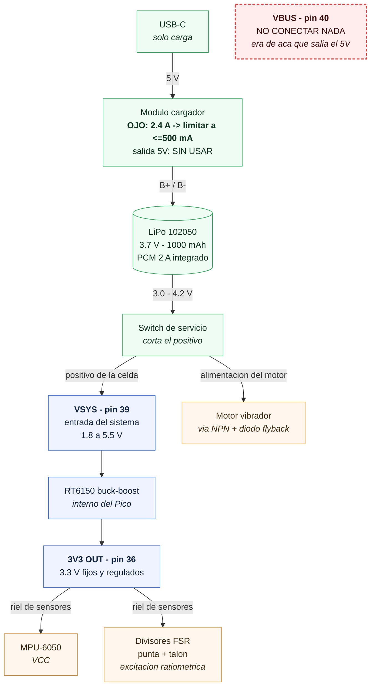

# Esquema de alimentación — guía de cableado

> **Qué es esto.** Guía de construcción del subsistema de alimentación de cada nodo (plantilla y cintura): cómo debe quedar cableada la batería, el cargador, el Pico 2 W y los sensores. Es una **guía de banco**, no un ADR: las decisiones de fondo están en **CP-19** (encendido/apagado, *en análisis*) y **CP-09** (presupuesto de energía).
>
> **Estado:** objetivo a implementar. Reemplaza el cableado inicial (celda → módulo → boost 5 V → **VBUS**), que se descartó por tres motivos documentados abajo.
>
> **Diagrama:** `esquema_alimentacion.mermaid`.

> ### Encendido/apagado: sin gestión de energía (ADR-035 rev)
>
> **El switch físico es el encendido y el apagado.** Mientras esté cerrado, las tres unidades están **despiertas y operando**: no hay dormant, ni auto-sleep, ni wake por movimiento. La autonomía alcanza sin dormir (~10 h contra el objetivo de ≥8 h de CP-09).
>
> **Ahora (placa actual):** este esquema se implementa **puenteando cables**, más un **switch físico en las tres placas**.
>
> **Próxima rev del PCB:** el criterio del corte pasa a ser **diferenciado por unidad** — slide switch en la **cintura**; en la **plantilla**, sin actuador mecánico (fina, sellada, bajo carga, con impactos), con corte por **JST/header accesible**. Ver el **checklist** en §7.
>
> **Diferido a la máxima:** *wake-on-motion* (dormant + INT del IMU) y *WiFi power-save*. Se descartaron para esta etapa porque los umbrales de movimiento son poco confiables en marcha hemipléjica y el auto-sleep **hace perder los primeros pasos** tras el reposo — justo lo clínicamente valioso.

---

## 1. Principio: tres dominios de alimentación separados

| Dominio | Fuente | Qué alimenta | Por qué |
|---|---|---|---|
| **Entrada del sistema** | Celda → **VSYS (pin 39)** | El Pico | VSYS acepta 1,8–5,5 V y el buck-boost interno mantiene 3,3 V aunque la celda caiga de 4,2 a 3,0 V |
| **Riel de sensores** | **3V3 OUT (pin 36)** | MPU-6050 + divisores FSR | Tensión fija y regulada, **misma referencia que el ADC** → medición ratiométrica |
| **Actuador** | Celda (VSYS) → NPN | Motor vibrador | Aísla el pico de corriente del motor del riel de sensores |

**Regla:** los sensores **nunca** se alimentan desde la celda directamente (tensión variable) ni desde 5 V (fuera del rango del ADC). El motor **nunca** se alimenta desde el riel de sensores.

---

## 2. Diagrama



---

## 3. Cambios respecto del cableado actual

| # | Antes | Después |
|---|---|---|
| 1 | Módulo **salida 5 V** → Pico **VBUS (pin 40)** | **Eliminar.** Nada se conecta a VBUS. |
| 2 | — | Módulo **B+** → switch de servicio → Pico **VSYS (pin 39)** |
| 3 | Sensores alimentados desde **5 V** | Sensores desde **3V3 OUT (pin 36)** |
| 4 | Salida de 5 V del módulo en uso | **Sin usar** (dejarla desconectada, no pasa nada) |

> **No es agregar un puente: es mover el cable.** Si quedan conectados a la vez el boost (5 V) y la celda (4,2 V), son dos fuentes peleando sobre el mismo nodo.

---

## 4. Tabla de conexiones (estado objetivo)

### Potencia

| Desde | Hasta | Nota |
|---|---|---|
| USB-C | Entrada del módulo cargador | Solo para cargar |
| Celda **+** / **−** | Módulo **B+** / **B−** | La celda queda siempre colgada del cargador |
| Módulo **B+** | **Switch** → **VSYS (pin 39)** | Positivo de la celda, 3,0–4,2 V. *Ahora: switch físico en las tres placas. Próxima rev: switch en cintura; en plantilla, JST/jumper accesible.* |
| Módulo **B−** | **GND (pin 38)** | Masa común (verificar continuidad B− ↔ GND del módulo) |
| **3V3 OUT (pin 36)** | VCC del MPU-6050 | Riel de sensores |
| **3V3 OUT (pin 36)** | Extremo alto de los divisores FSR | Excitación ratiométrica |
| Celda **+** (después del switch) | Alimentación del motor | **No** desde 3V3 |
| — | **VBUS (pin 40)** | **Sin conexión** |

### Señales

| Desde | Hasta | Pin físico | Nota |
|---|---|---|---|
| MPU-6050 **SDA** | GP20 | 26 | I²C0 |
| MPU-6050 **SCL** | GP21 | 27 | I²C0 |
| MPU-6050 **INT** | GPIO libre | — | **A rutear en la próxima rev del PCB** (CP-01): habilita DATA_READY (ADR-026) y *wake-on-motion* (CP-19) |
| Nodo divisor FSR **punta** | GP26 / ADC0 | 31 | 0–3,3 V |
| Nodo divisor FSR **talón** | GP27 / ADC1 | 32 | 0–3,3 V |
| GP18 | Base del NPN (con resistencia de base) | 24 | PWM del motor |
| Motor | Colector del NPN + **diodo flyback** | — | Alimentado desde VSYS |

### Divisor FSR (por sensor)

```
3V3 (pin 36) ──[ FSR ]──┬──► ADCn
                        │
                     [ R_fija ]
                        │
                       GND
```

Con el FSR arriba, la tensión del nodo **sube con la fuerza** (el FSR baja su resistencia al comprimirse). `R_fija` fija el rango de sensibilidad — típicamente del orden de 10 kΩ, a ajustar según el rango de fuerza esperado (queda como parámetro de calibración).

**Ventaja del riel de 3,3 V:** el nodo del divisor **no puede superar 3,3 V por construcción**, así que es imposible sacar el ADC de rango.

---

## 5. Verificación antes de energizar

1. **Continuidad** entre el pad **B−** del módulo y su **GND de salida** → debe dar ≈0 Ω (si es así, el cable de masa actual sirve tal cual).
2. Con la celda conectada, medir entre **B+ y B−** → debe leer **3,0–4,2 V**. Si lee ~5 V, es el pad equivocado.
3. Con los cables ya soldados pero **sueltos del Pico**, medir en las puntas → **polaridad correcta** y valor en 3,0–4,2 V.
4. Confirmar que **nada** quedó conectado a **VBUS (pin 40)**.
5. Con el sistema andando, verificar que el nodo del divisor FSR **con el sensor totalmente comprimido** no supere 3,3 V.
6. Si el IMU es un módulo tipo GY-521: verificar a dónde van sus **pull-ups de I²C** (deben ir al lado de 3,3 V, nunca a 5 V — los GPIO del RP2350 no toleran 5 V).

---

## 6. Por qué este esquema (resumen del análisis)

- **La salida de 5 V del módulo no sirve como alimentación permanente.** Comprobado en banco: el boost arranca apagado (necesita que se enchufe el USB para encenderse) y **se apaga solo cuando el consumo es bajo** — comportamiento propio de estos integrados de carga/descarga. Con el micro en dormant (~800 µA) el boost cortaría, lo que hace **imposible** el *wake-on-motion* de CP-19.
- **Alimentar VSYS desde la celda es lo que documenta el fabricante.** El datasheet del Pico 2 indica que es seguro alimentar por VSYS en el rango 1,8–5,5 V y menciona explícitamente las celdas de litio. El **RT6150 buck-boost** mantiene 3,3 V estables en todo el rango de descarga.
- **Se elimina una conversión y una caída de diodo.** El camino anterior era celda → boost 5 V → **D1 (Schottky)** → RT6150 → 3,3 V. El nuevo es celda → RT6150 → 3,3 V. Se recupera del orden del **20 % de autonomía**, que es lo que hace la diferencia entre cumplir o no el objetivo de ≥8 h de CP-09.
- **Menos ruido en el ADC.** El boost aportaba **100 mV de ripple** a la excitación de los FSR. Alimentar los divisores desde el mismo riel que referencia el ADC hace la medición **ratiométrica**: la deriva del riel se cancela en la lectura. Refuerza el objetivo de SNR de ADR-014.
- **Programar con la batería puesta pasa a ser seguro.** Con la celda en VSYS, el diodo D1 hace *power ORing* (gana la fuente más alta y no hay retroalimentación al USB). Con el módulo en VBUS, en cambio, quedaban **dos fuentes de 5 V unidas directamente** (la del módulo y la de la laptop).

**Autonomía estimada** (1000 mAh, alimentando VSYS directo): ~10 h a 100 mA de consumo medio; **>50 días** en dormant a 800 µA. El reposo no es el problema — el consumo activo sí (CP-09).

---

## 7. Checklist de la próxima rev del PCB

> Consolidado para que sea **una sola vuelta de rediseño**. Incluye lo de alimentación y todo lo demás que quedó pendiente de placa.

| # | Cambio | Prioridad | Ref |
|---|---|---|---|
| 1 | **Cargador con corriente limitada (~200–500 mA).** El módulo actual entrega **2,4 A** y la celda admite **0,2C estándar / 0,5C máx** (200/500 mA). Cambiar por un cargador de corriente ajustable por resistor. | **Alta (seguridad)** | CP-09 |
| 2 | **FSR medial y lateral** (3º y 4º) a **ADC2/GP28** + otro canal. Desbloquea el **bloque E completo** (COP_ML #22-25), la **#18** (ratio M/L) y la **#42** (sway density), hoy definidas pero desactivadas. **Decidir ahora** si se van a 4 FSR: excede los ADC libres del Pico y exige **mux analógico**. | Alta | CP-01, CP-08, ADR-023, ADR-029 |
| 3 | **Traza INT del IMU → GPIO.** Habilita el fallback **DATA_READY** (ADR-026) y deja la puerta abierta al *wake-on-motion* de la máxima. *(Ya no es crítica: ADR-035 rev descartó la gestión de energía en la mínima.)* | Media | CP-01, ADR-026, ADR-035 |
| 4 | **Alimentación según este documento:** celda → VSYS, sensores desde 3V3, motor desde VSYS por NPN, **VBUS sin conexión**. | Alta | ADR-035 |
| 5 | **Señal de estado del cargador (CHRG/STDBY) → GPIO.** Permite detectar carga en curso ("en el cargador = sincronizando") y evitar que el consumo del micro moleste la detección de fin de carga. | Media | ADR-035 |
| 6 | **Corte de servicio diferenciado:** **cintura** = slide switch en serie con el positivo; **plantilla** = **sin actuador mecánico** (fina, sellada, bajo carga, con impactos → un reed switch rebotaría), corte por **JST/header accesible** al abrir la carcasa. | Media | ADR-035 |
| 7 | **Alojamiento y elección de la celda.** El 102050 mide **10 × 20 × 52 mm**: sirve para la cintura, **no entra bajo el pie**. Definir celda más fina para la plantilla (menos capacidad → menos autonomía) o reubicarla, con protección mecánica contra compresión y flexión cíclica. | Media (seguridad) | CP-09, CP-18 |
| 8 | **Pulsador de reset sobre RUN** (opcional, depuración). | Baja | ADR-035 |
| 9 | **Tensión nominal del motor:** muchos vibradores de moneda son de 3 V; verificar antes de colgarlo de una celda a 4,2 V. | Baja | — |

### Pendientes de firmware asociados

| # | Pendiente | Ref |
|---|---|---|
| A | **Corte por baja tensión:** leer VSYS por el ADC y apagar ordenadamente antes de que actúe el PCM (un corte duro puede corromper la flash). **Gana importancia sin dormant:** un equipo que quede encendido consume hasta agotar la celda. | ADR-035 |
| B | **Heartbeat cintura→plantillas** para **salud del enlace** (detectar una plantilla caída o sin batería). No es gestión de energía. | ADR-035 |

*(Quedaron **sin efecto** con la revisión de ADR-035: auto-sleep dependiente del modo, indicador de encendido por pulso del motor y secuencia de wake cintura↔plantillas. Se reactivarían si en la máxima se adopta wake-on-motion o WiFi power-save.)*

> **Antes de sellar la primera plantilla:** al quedar cerrada se pierde el acceso físico al **BOOTSEL**, así que el **OTA (ADR-012) tiene que estar probado y funcionando** antes de ese punto.

---

## Referencias
- Datasheet Raspberry Pi Pico 2 — rango de VSYS (1,8–5,5 V), RT6150 buck-boost, alimentación por batería y *power ORing* con D1.
- Especificación de la celda 102050 (1000 mAh): 10 × 20 × 52 mm, carga estándar 0,2C / máx 0,5C, PCM 2 A.
- ADR-014 (adquisición y SNR del ADC) · ADR-026 (lectura del IMU, DATA_READY) · ADR-028 (sin botón, gesto por IMU) · CP-01 · CP-09 · CP-18 · CP-19.
