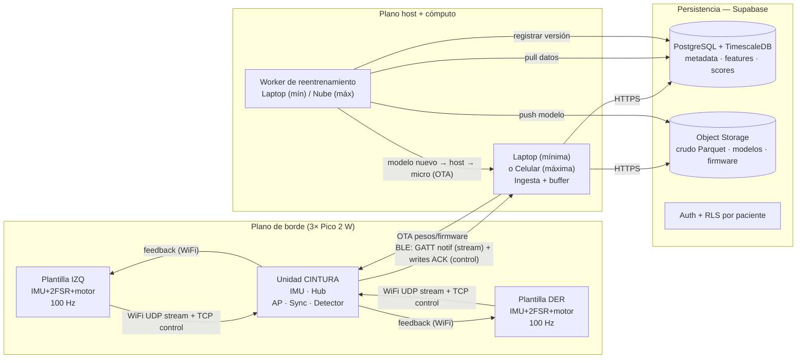

# Vista 1 — Sistema (general)

> **Nivel de abstracción:** alto. La "foto" del sistema: qué nodos hay, cómo se conectan y cómo fluyen los datos de punta a punta. No entra en internals de firmware (Vista 2) ni en fórmulas de features (Vista 3).
>
> **Estado:** consolidada — el detalle migró aquí desde el maestro (§3–§7, §13). El maestro conserva un overview + puntero a esta vista.

## 1. Nodos y hardware

| Nodo | Cómputo | Sensores | Actuador | Rol |
|---|---|---|---|---|
| **Plantilla izquierda** | Raspberry Pi Pico 2 W (RP2350, Cortex-M33 @150 MHz, 520 KB SRAM, WiFi+BLE CYW43439) | MPU-6050 (IMU 6-DOF, I²C) + **2× FSR** (ADC0-1; punta+talón) | Motor vibrador (PWM) | Sensado del pie izq + feedback |
| **Plantilla derecha** | Ídem | Ídem | Motor vibrador (PWM) | Sensado del pie der + feedback |
| **Unidad de cintura** | Raspberry Pi Pico 2 W | MPU-6050 | — | **Hub**: AP WiFi, maestro de sync, fusión bilateral, detección, uplink BLE |

**Muestreo:** 100 Hz. **Canales por pie:** **11 hoy** — `lin_accel` XYZ (sin gravedad), giro XYZ y **orientación** pitch/roll/yaw, más **2× FSR** (ADR-042); el formato de paquete reserva **4 slots** de FSR — el máximo de diseño (ADR-041). La cintura suma su IMU (6 canales) como referencia de tronco/pelvis (~L4-L5), que habilita las features del bloque I.

**Pinout de referencia (plantilla).** Hoy hay **2 FSR conectados**: **ADC0/GP26 (punta)** y **ADC1/GP27 (talón)** — eje antero-posterior. El 3º/4º FSR (**medial/lateral**, para COP_ML) van a **ADC2/GP28** (+ otro) en una **etapa posterior** de la placa (**ADR-023**; CP-01/CP-08). Hasta entonces, las features de fuerza medio-lateral (bloque E + #18) quedan **definidas pero desactivadas** en el set activo.

| GPIO | Pin | Modo | Conectado a |
|---|---|---|---|
| GP20 | 26 | I²C0 SDA | IMU MPU-6050 |
| GP21 | 27 | I²C0 SCL | IMU MPU-6050 |
| GP26 | 31 | ADC0 | FSR 1 — **punta** (divisor) |
| GP27 | 32 | ADC1 | FSR 2 — **talón** (divisor) |
| GP28 | 34 | ADC2 | FSR 3 — medial/lateral (divisor) *(a futuro — ADR-023)* |
| GP18 | 24 | PWM | Base NPN → motor vibrador (con diodo flyback) |

**Radio (coexistencia).** El CYW43439 es un único chip WiFi+BLE con **una antena** en 2.4 GHz. La cintura sostiene **WiFi-AP (a las plantillas) + BLE (al host)** en simultáneo por **coexistencia** (time-division del radio). Es un requisito permanente de la máxima, asumido desde la mínima (ver Riesgos, maestro §15).

## 2. Vista general (cuatro planos)

1. **Plano de sensado y borde** (los 3 micros): adquisición a 100 Hz, sincronización, detección de eventos, cálculo de features (captura operativa / edge), inferencia local (clases L/E) y feedback vibrotáctil.
2. **Plano de transporte:** WiFi (plantillas↔cintura) y BLE (cintura↔host), cada uno con un **canal rápido-tolerante** (stream) + un **canal confiable** (control/modelos).
3. **Plano de host y cómputo:** laptop (mínima) o celular + worker en la nube (máxima). Ingesta, entrenamiento/reentrenamiento pesado, orquestación.
4. **Plano de persistencia:** Supabase (PostgreSQL + TimescaleDB + object storage + auth), **sistema de registro** de datos, features, scores y modelos.

## 3. Topología de red

### 3.1 Plantillas ↔ cintura — WiFi, cintura como Access Point
La cintura crea su propia red WiFi (SSID propio) y actúa como **Access Point (AP)**; las dos plantillas se conectan como **estaciones (STA)**. Este enlace es **permanente**: no cambia entre mínima y máxima. La cintura es, por diseño, el punto de convergencia de ambos pies → el lugar natural de la fusión bilateral (Vista 3 / maestro §8). **Justificación:** una estrella de un solo salto minimiza complejidad, no depende de infraestructura externa (funciona en cualquier lado) y coloca la fusión donde los datos ya coinciden. [ADR-001]

### 3.2 Cintura ↔ host — BLE desde la mínima
La cintura expone un **servidor GATT BLE**; el host (laptop en mínima, celular en máxima) es el **central**. Se adopta BLE **desde la mínima** porque: el firmware BLE de la cintura es **idéntico** mande a laptop o celular (periférico agnóstico al central → se reutiliza al 100 % en la máxima); se enfrenta **temprano** el riesgo central de la máxima (coexistencia WiFi-AP + BLE); y el caudal (~5 KB/s) está **muy por debajo** de lo que BLE soporta. **Restricción de diseño:** dimensionar a las restricciones del celular desde el inicio (MTU BLE ~185 B en iOS, límites de connection-interval). **Beneficio colateral:** el uplink no ocupa el WiFi del host → la laptop conserva internet para empujar a Supabase. [ADR-002]

### 3.3 Modelo de conectividad (tipo auriculares BLE)
Los micros funcionan como **auriculares Bluetooth**: **nunca se conectan a una red WiFi de internet**. El único WiFi es el enlace **privado** plantillas↔cintura (cintura = AP, sin salida a internet). La cintura habla con su **host** (compu/celu) sólo por **BLE**, y es el **host** quien tiene internet y empuja a Supabase; el **OTA** de pesos/firmware también va **por BLE** desde el host. No hay provisioning de redes de infraestructura. El emparejado plantilla↔cintura es **fijo/de fábrica**. **Pairing cintura↔host (ADR-028):** auto-advertise sin bond (primer uso) + **gesto sin botón** (sacudir la cintura ~5 s con las plantillas quietas) para re-emparejar; **passkey fijo impreso** (v1); **bond list multi-host** (reconecta el host que inicia, uno a la vez). Clear-all/pantalla → máxima; UX en la app (CP-15).

## 4. Transporte y protocolos

Principio: **dos canales por enlace**, uno optimizado para latencia y otro para integridad. [ADR-003]

| Enlace | Canal rápido-tolerante (stream 100 Hz) | Canal confiable (control, modelos, config) |
|---|---|---|
| **Plantillas ↔ cintura (WiFi)** | **UDP** con nº de secuencia + timestamp por muestra | **TCP** |
| **Cintura ↔ host (BLE)** | **Notificaciones GATT** (sin ACK) | **Writes con respuesta / Indicaciones** (con ACK) |

**Justificación.** A 100 Hz, perder una muestra ocasional es irrelevante (la próxima llega en 10 ms), mientras que la retransmisión de TCP mete *head-of-line blocking* — picos de latencia en el peor momento del stream. UDP con seq+timestamp detecta y tolera huecos sin frenar el flujo. TCP para control porque pesos/firmware exigen **todos los bytes en orden**. Sobre BLE el mismo principio: **notificaciones** (≈UDP) + **writes con ACK/indicaciones** (≈TCP).

**Formato de paquete de muestra (stream):** `[device_id | seq (uint32) | t_device (uint64, µs) | ax ay az (int16, lin_accel) | gx gy gz (int16) | pitch roll yaw (int16) | fsr1 fsr2 fsr3 fsr4 (uint16)]`.

**Qué viaja (ADR-042).** El IMU va **post-AHRS**: aceleración lineal **sin gravedad**, giro calibrado y **orientación**. La orientación tiene que viajar porque, una vez removida la gravedad, **no se puede reconstruir** desde el dato guardado (integrar el giro solo deriva sin la referencia de vertical) — y el bloque F (#26-29) y SPEC-03 la necesitan para el cálculo off-device de la fase exploratoria. Cuesta 6 B/muestra.

**`t_device` es `uint64` (CP-27).** En `uint32` de µs el contador da la vuelta a los **71,6 min**, y ADR-035 deja el equipo despierto ~10 h de corrido (~8 vueltas): eso desordena el emparejado entre pies y rompe la regresión de drift de ADR-004. Con 8 B el problema desaparece por 584.000 años, a costa de 4 B/muestra. El `seq` en `uint32` está bien: a 100 Hz tarda **497 días**.

**Costo total:** 29 → **35 B/muestra** ≈ **7 KB/s** entre las dos plantillas (contra ~5,8 antes). Mismo orden que los slots de FSR de ADR-041; BLE lo absorbe. **Cuatro slots fijos de FSR** — el máximo de diseño (**ADR-041**) — con los no poblados en cero; hoy sólo `fsr1` (punta) y `fsr2` (talón) llevan dato. El **set activo del catálogo** (ADR-021) declara cuáles son válidos, así que **el protocolo no cambia al sumar hardware**. Cuesta 4 bytes por muestra (400 B/s por pie sobre ~5 KB/s totales) y evita versionar el protocolo con plantillas ya selladas. El `seq` y `t_device` son la base de la sincronización (§5) y de la detección de pérdidas.

## 5. Sincronización (alto nivel)

La sincronización es crítica: la **simetría inter-miembro** exige relacionar ambos pies sobre una **misma línea de tiempo a nivel de muestra**. Muchas features se calculan sobre **ventanas de la señal bilateral** o requieren **simultaneidad** (double support; velocidad/cruces por cero del COP-ML; LDLJ; entropías; PSD). El emparejado por evento por sí solo **no** alcanza. [ADR-004]

- **Backbone de reloj — único mecanismo de sincronización:** timestamp + nº de secuencia por muestra (alinea por instante de generación, no de llegada) + **beacon** periódico que la cintura emite **por WiFi** a las plantillas (estilo *Reference Broadcast*) + **corrección de drift** por regresión lineal (offset + skew). Va en la **capa de aplicación**, así que el mecanismo es portable a otro transporte, pero **el enlace que hay que sincronizar a nivel de muestra es plantillas↔cintura, que es WiFi y no cambia entre mínima y máxima**. La precisión alcanzable no está fijada como requisito: el presupuesto de error es **CP-28**. Es lo que ordena las muestras de ambos pies (ventanas, simultaneidad) y lo que **corrige el drift** de cristal.
- **Emparejado de zancadas — usa el reloj ya sincronizado, no es sync:** el **contacto inicial (IC)** (umbral FSR + pico IMU) se detecta igual para las features espacio-temporales; sobre el **timeline común** del backbone, los tiempos de IC de cada pie **asocian la zancada izquierda con la derecha** para la simetría **por zancada** (Symmetry Index). O sea: **con los relojes sincronizados (beacon) se emparejan las zancadas** — el IC no sincroniza nada.

**Que quede claro (ADR-004):** el IC **no** sincroniza relojes ni es una "red de seguridad" ante el drift — de eso se encarga el **backbone** (corrección de drift). El IC es sólo el **marcador biomecánico de zancada**, y el emparejado izq↔der es una **consecuencia de tener el reloj sincronizado**. Un IC anómalo es **señal de anomalía** (se mide como feature); usarlo como marca temporal de zancada no entra en conflicto con medir su morfología.

> El **detalle de implementación** de la sincronización (beacon en firmware, regresión de drift, formato del mensaje de referencia) vive en la **Vista 2** (firmware).

## 6. Dónde corre cada operación

| Operación | Captura (dataset/eval) | Edge (uso real) |
|---|---|---|
| Muestreo 100 Hz | Plantillas | Plantillas |
| Detección de eventos (IC/TO) | Plantilla (per-pie) | Plantilla (per-pie) |
| Cálculo de features por-pie | Exploratoria: **off-device (Python)** · Operativa: **plantillas (on-device)** | **Plantillas (on-device)** |
| Fusión bilateral (simetría, double support) | **Cintura** | **Cintura** |
| Inferencia en tiempo real (feedback) | Opcional, en host, sólo para evaluar | **Cintura (hub)** o **host** — clases L/E/H; nunca en el worker |
| Inferencia batch/offline (análisis, re-scoring) | Worker | Worker — clase W |
| Adaptación online (clase L) | Según `adaptation_enabled` de la sesión; estado en RAM, se versiona en el check-in [ADR-043 rev] | Ídem |
| Reentrenamiento | L: cintura · E/H/W: worker (laptop) | L: cintura · E/H/W: worker (nube) |
| Almacenamiento de crudo | Continuo → host → object storage | Snippet por anomalía → host → storage |
| Almacenamiento features/scores | Operativa: features del micro → DB (junto al crudo) | Continuo → host → DB |
| Feedback vibrotáctil | (opcional) | Cintura decide → motor de la plantilla |

En una línea: **tiempo real y feedback = cintura (o host si el modelo no entra); entrenamiento pesado y análisis offline = worker; el host es puente + almacenamiento** (y, en clase H, motor de inferencia RT). [ADR-013, ADR-011 rev]

## 7. Evolución mínima → máxima

| Componente | Mínima | Máxima | ¿Cambia? |
|---|---|---|---|
| Plantillas ↔ cintura | WiFi (AP), UDP+TCP | Ídem | **No** |
| Sincronización | Backbone reloj (capa app, beacon por WiFi) + IC | Ídem | **No** |
| Cintura ↔ host | **BLE** (GATT) | **BLE** (GATT) | **No** (sólo cambia el central) |
| Host | Laptop (ingesta + worker) | Celular (ingesta + puente) | Sí (app) |
| Worker de reentrenamiento | Laptop | **Nube** | Sí (ubicación) |
| Base de datos | Supabase | Supabase | **No** |
| Retención | Tiered (dataset) | Tiered (crudo por anomalía) | Evoluciona la fase |
| OTA | Pesos + firmware A/B | Ídem | **No** |

Los únicos puntos de variación (app del host y ubicación del worker) están **aislados detrás de interfaces** (transporte y despliegue), por lo que la migración no toca el borde ni la persistencia.

**El switch mínima↔máxima no existe en el micro (CP-16 / ADR-034).** El micro es **agnóstico al tipo de central**: no detecta si habla con una computadora o un celular, y su firmware es idéntico en ambos horizontes. **El flujo lo determina el host** (laptop → worker local; celular → worker en la nube). El **modo** de operación (captura exploratoria / operativa / edge) es un **comando explícito** por el canal de control (UI, ADR-033), nunca una inferencia sobre el tipo de host. El host **declara su tipo** (`sessions.host_type`) al abrir la sesión, sólo para **trazabilidad del dataset**.

## ADRs relevantes
ADR-001 (topología WiFi/AP), ADR-002 (uplink BLE), ADR-003 (transporte), ADR-004 (sincronización), ADR-013 (ubicación de inferencia), ADR-011 rev (ruteo micro→host), **ADR-042** (crudo post-AHRS y formato de paquete), **ADR-043 rev** (ciclo de vida de la sesión).

## Stack (resumen; detalle en `../stack_tecnologico.md`)
WiFi (lwIP), BLE (BTstack), sincronización de capa de aplicación (código propio).

**Diagrama de esta vista:** `../diagrama_arquitectura.mermaid` (topología + flujos); reproducido en §2.

## Pendiente de definir / investigar
- **CP-01:** confirmar el 3er FSR en ADC2/GP28 contra el PCB.
- Provisioning de credenciales WiFi (sólo si se adopta red de infraestructura; hoy no requerido).
- Compresión de datos en transmisión (sólo si es necesario).
