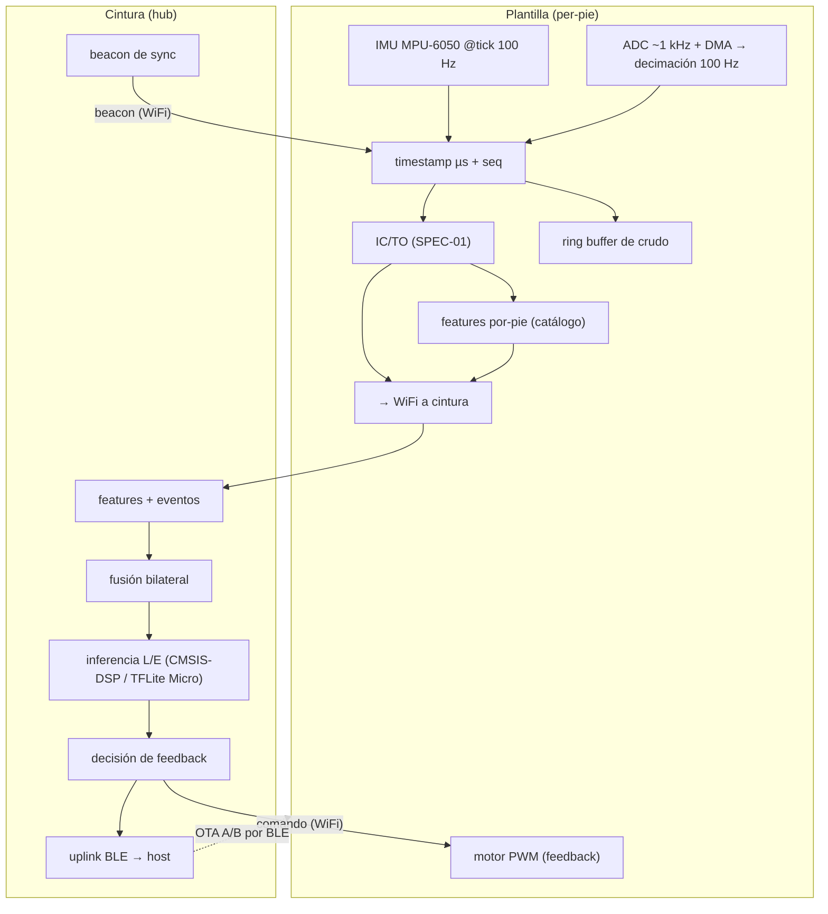

# Vista 2 — Dispositivo / Firmware

> **Nivel de abstracción:** internals de los micros (C/C++, Pico SDK). Cómo cada dispositivo **adquiere, procesa y actúa** en tiempo real. Aquí vive la **ejecución** de los algoritmos; su **definición** canónica está en la Vista 3 (regla: se define en V3, se ejecuta en V2 + worker).
>
> **Estado:** consolidada — el detalle migró aquí desde el maestro (§8.2/8.3/8.6, §10.2). El maestro conserva un overview + puntero.
>
> **Specs de algoritmos (guías de implementación):** `2_specs_algoritmos_firmware.md` — SPEC-01 (IC/TO), SPEC-02 (segmentación), SPEC-03 (stride/ZUPT), SPEC-04 (módulo IMU), SPEC-05 (buffer de zancadas), SPEC-06 (COP_ML, **diferido** ADR-023), SPEC-07 (FFT/DSP), SPEC-08 (runtime de inferencia), SPEC-09 (feedback vibrotáctil).

## 1. Arquitectura de firmware (dos builds + código compartido)

Dos firmwares en **C/C++ con el Pico SDK** [ADR-010], con **código compartido** en `src/firmware/shared/` (protocolo de paquetes, **definición de features** —catálogo, ADR-021—, sincronización y OTA):

- **Plantilla (insole):** adquiere a 100 Hz, detecta IC/TO, calcula **features por-pie**, mantiene un buffer de crudo y acciona el **motor PWM**.
- **Cintura (waist):** **AP WiFi**, **maestro de sync** (beacon), **fusión bilateral**, **inferencia + decisión de feedback**, **uplink BLE**.

## 2. Adquisición determinística (100 Hz) — [ADR-014]

Muestreo **exacto y periódico** pese a la actividad del radio (el jitter arruina derivadas/espectro y ensucia la sync). El estándar: **el hardware dispara la conversión y el DMA la almacena, sin CPU en el lazo de tiempo**. Todo interno al RP2350, **sin componentes extra en el PCB**.

- **FSR (ADC):** ADC **free-running** a ~**1 kHz** + **DMA** a buffer; **decimación ×10 (promedio) a 100 Hz** → además **baja el ruido del FSR** (√10 ≈ 3,2×). El 1 kHz se decima al vuelo y **se descarta** (sólo viaja el 100 Hz). **Hoy 2 FSR:** punta (ADC0/GP26) + talón (ADC1/GP27) — ADR-023.
- **IMU (MPU-6050):** lectura en el **tick maestro de 100 Hz** por **DMA** (un timestamp por tupla FSR+IMU), con **ODR interno alto (~1 kHz) + DLPF** (sobremuestreo anti-alias) — **ADR-026**. **DATA_READY** = fallback (traza INT→GPIO en la próxima rev del PCB); FIFO descartada.
- **Común:** cada muestra con **timestamp (timer µs) + nº de secuencia**; **core dedicado** a adquisición (aislado del radio); buffer DMA para no perder ante picos del radio.

> **Diagrama:** `../adquisicion_dma_irq.mermaid` — cadena **timer → IRQ → DMA → buffer** con la **inferencia corriendo al lado**: por qué el muestreo a 100 Hz no lo frena la inferencia (la IRQ sólo la preempta ~µs y el DMA mueve los datos sin CPU). Aplica al core 1 de la cintura (IMU + inferencia juntos).

## 3. Detección de eventos y ejecución de features

- **IC/TO/MS** (núcleo del firmware): fusión **FSR-primario + confirmación IMU**, per-pie — **SPEC-01** (ADR-015 para IC/TO; **ADR-038** para **mid-stance**, detectado como cruce de carga retropié→antepié). Alimenta features espacio-temporales, segmentación, ZUPT, refinamiento de sync y timing del feedback. **Segmentación stance/swing + sub-fases del apoyo** (carga `[IC,MS]` / propulsión `[MS,TO]`)**:** SPEC-02.
- **Módulo de features por-pie (ejecución):** el firmware **implementa** las features desde el **catálogo compartido** (definición única, ADR-021); su definición canónica vive en la Vista 3. Corre en **captura operativa y edge** (no en la exploratoria — ADR-005 rev c). Aplica el **set activo** vigente (perfil **2-FSR**: bloque E + #18 **OFF**, ADR-023).
- **Dependencias de cómputo:** módulo IMU (orientación/gravedad — SPEC-04), buffer de N zancadas (SPEC-05), stride length/ZUPT (SPEC-03), COP_ML (SPEC-06, **diferido**), FFT/DSP con **CMSIS-DSP** (SPEC-07, ADR-019).
- **Fusión bilateral (cintura):** simetría (bloque D) y **double support** desde los **eventos alineados** por el backbone de sync — no necesita el crudo de ambos pies co-localizado.

## 4. Sincronización (implementación) — [ADR-004]

La **cintura emite el beacon** periódico; cada muestra lleva **timestamp + seq**; la **corrección de drift** (regresión lineal) corre en la **capa de aplicación** (portable WiFi↔BLE). El **backbone es el único que sincroniza**; el **emparejado de zancadas por IC usa el reloj ya sincronizado** — no sincroniza ni compensa drift (ver Vista 1 §5).

## 5. Inferencia on-device — [ADR-020 / SPEC-08]

Corre en la **cintura** (hub); si un modelo no entra, pasa al **host** (switch por config `inference_target`, model-agnostic — ADR-011 rev). Nunca en el worker para tiempo real.

- **Mahalanobis (L):** álgebra lineal en **C + CMSIS-DSP**, **<100 µs**; caballo de batalla del feedback y **sensor de drift**.
- **Autoencoder denso int8 (E):** **TFLite Micro + CMSIS-NN** (`pico-tflmicro`); score = error de reconstrucción.
- **Isolation Forest (E):** recorrido de árboles (tablas de splits) en **C**.
- **LSTM AE:** por TFLM **si entra**; si no, host/offline.

## 6. Feedback vibrotáctil — [§8.3]

El detector corre en la **cintura**, pero el **motor está en la plantilla** → el enlace plantillas↔cintura es **bidireccional** (datos arriba, **comando de feedback abajo** por WiFi). **Es monitoreo + alerta, no corrección** (ADR-027): score designado (`feedback_source`, model-agnostic) evaluado sobre **ventana de zancadas** → anomalía **sostenida** → **3 bandas** per-paciente (leve/marcada/riesgo) → **alerta escasa** (histéresis+refractario) → **3 ritmos** en el PWM, ambos pies. Detalle: **SPEC-09**; config per-paciente en DB (Vista 4).

## 7. Buffer circular de crudo

Cada plantilla mantiene un **ring buffer** de crudo; en **edge**, ante una anomalía la cintura **pide el snippet** y se envía (§10.3). En **captura operativa** se sube el crudo **continuo** junto con las features del micro.

## 8. OTA A/B (pesos + firmware) — [ADR-012 / §10.2]

**OTA completo desde el inicio**, por **BLE** desde el host, esquema **A/B**:

- **Pesos (modelos):** artefacto del modelo (Mahalanobis = μ + Σ⁻¹; AE/LSTM = **flatbuffer int8** de TFLite Micro) a un **slot** de flash; **checksum** → **conmutación atómica** → el anterior queda **last-known-good** para rollback.
- **Firmware:** **bootloader A/B** con dos imágenes; arranca la nueva y **revierte** si no reporta OK. Se mitiga el brickeo con A/B + checksum + **watchdog** + modo de recuperación. Flash: dos firmwares + dos slots, dentro del RP2350.

## 9. Asignación de cores y RTOS — [ADR-024 rev · ADR-025 · ADR-026]

**Reparto uniforme (ADR-024 rev 2026-07-20):** en los tres micros, **core 0 = radio**, **core 1 = procesamiento**. Difiere la *carga*, no el *rol*:

- **Plantilla** (WiFi-STA sólo, **sin BLE/coexistencia**, **no infiere**): **core 0 = WiFi-STA + TX + motor**; **core 1 = adquisición (100 Hz duro) + eventos IC/TO + features por-pie**. Se agrupa el *pipeline de sensado* en el core 1 (data locality: el crudo a 100 Hz no cruza de core) y se aísla el WiFi —el inquilino de latencia impredecible— en el core 0. *(Las features **bilaterales** —simetría, double support— no se calculan acá: van en la cintura, ADR-005.)*
- **Cintura** (acota el radio + la inferencia): **core 0 = radio** (WiFi-AP + BLE, **coexistencia**, donde lo pone el SDK); **core 1 = inferencia + fusión bilateral + IMU + decisión**. La **coexistencia** WiFi-AP+BLE (riesgo maestro §16) es **sólo de la cintura**. El **IMU se lee por DMA** (ADR-026) para no competir con la inferencia del core 1.

**Comunicación entre cores:** FIFO de hardware (`multicore_fifo_*`) / `queue_t` con spinlocks (Pico SDK).

**RTOS: bare-metal en ambos firmwares** (Pico SDK, sin RTOS; scheduling a mano con las primitivas multinúcleo — **ADR-025**). **Rate del IMU de la cintura (CP-17): 100 Hz + DMA** (uniforme), con **50 Hz** como fallback validable en #11 — **ADR-026**. *Gestión multinúcleo a nivel código: nota conceptual de ADR-024.*

## 10. Emparejamiento BLE (pairing, sin botón) — [ADR-028]

El pairing user-facing es **cintura↔host** (plantilla↔cintura es de fábrica). Sin botón ni pantalla:

- **Entrar en pairing:** auto-advertise cuando no hay bond (primer uso) + **gesto**: la cintura entra si su IMU ve una **sacudida marcada ~5 s** *y* las **plantillas están quietas** (condición multi-IMU anti falsos disparos), con ventana temporal.
- **Autenticación:** **passkey fijo impreso** (BTstack Security Manager, Passkey Entry / LE Secure Connections). *(OOB / passkey por sesión con pantalla → máxima.)*
- **Bond list:** **multi-host N≈4** (configurable, `le_device_db`); reconexión **iniciada por el host** (una conexión a la vez, primero en llegar); evicción **LRU** o forget explícito.
- **Dependencias:** CP-04 (nivel de seguridad + borrar bonds/datos al reasignar), CP-15 (UX de la app). Apéndice conceptual en **ADR-028**.

## ADRs relevantes
ADR-010 (C/C++ Pico SDK), ADR-014 (adquisición), ADR-026 (muestreo/lectura del IMU), ADR-004 (sync), ADR-005 (features distribuidas — ejecución), ADR-015/016/017 (SPEC-01/03/04), ADR-019 (CMSIS-DSP), ADR-020 (TFLite Micro), ADR-012 (OTA), ADR-011 rev (ruteo), ADR-023 (set activo 2-FSR), ADR-024 rev (cores) / ADR-025 (bare-metal), ADR-027 (feedback vibrotáctil), ADR-028 (pairing BLE).

## Stack (resumen; detalle en `../stack_tecnologico.md`)
Pico SDK (`hardware_adc/dma/timer/pio/i2c`), **lwIP**, **BTstack**, **CMSIS-DSP** (DSP/FFT/álgebra), **TFLite Micro + CMSIS-NN** (`pico-tflmicro`, int8), **Fusion** (Madgwick), driver I²C MPU-6050 (lectura por **DMA** — ADR-026). **Bare-metal** (sin RTOS — ADR-025).

**Diagrama de esta vista:** pipeline de firmware (arriba) + `../adquisicion_dma_irq.mermaid` (adquisición por DMA/IRQ sin frenar la inferencia del core 1). Un diagrama de calibración/baseline vive en la Vista 3.

## Pendiente de definir / investigar (backlog)
- **Validación de footprint/latencia** (#11) contra los objetivos (feedback <50 ms, Mahalanobis <100 µs, AE ~ms); incluye confirmar el reparto de cores de la plantilla (ADR-024 rev) y el rate del IMU de la cintura (100 Hz vs 50 Hz — ADR-026).

*(Resueltos: **CP-07** lectura del IMU → ADR-026; **CP-10** patrones de feedback → ADR-027/SPEC-09; **CP-14** pairing BLE → ADR-028; **asignación de cores** → ADR-024 rev; **RTOS y rate del IMU de cintura (CP-17)** → ADR-025/026.)*
