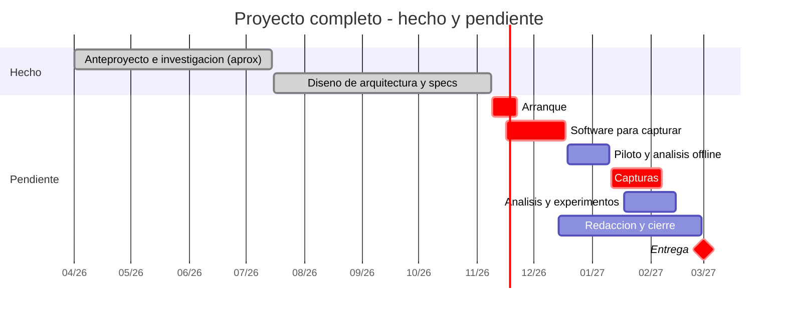
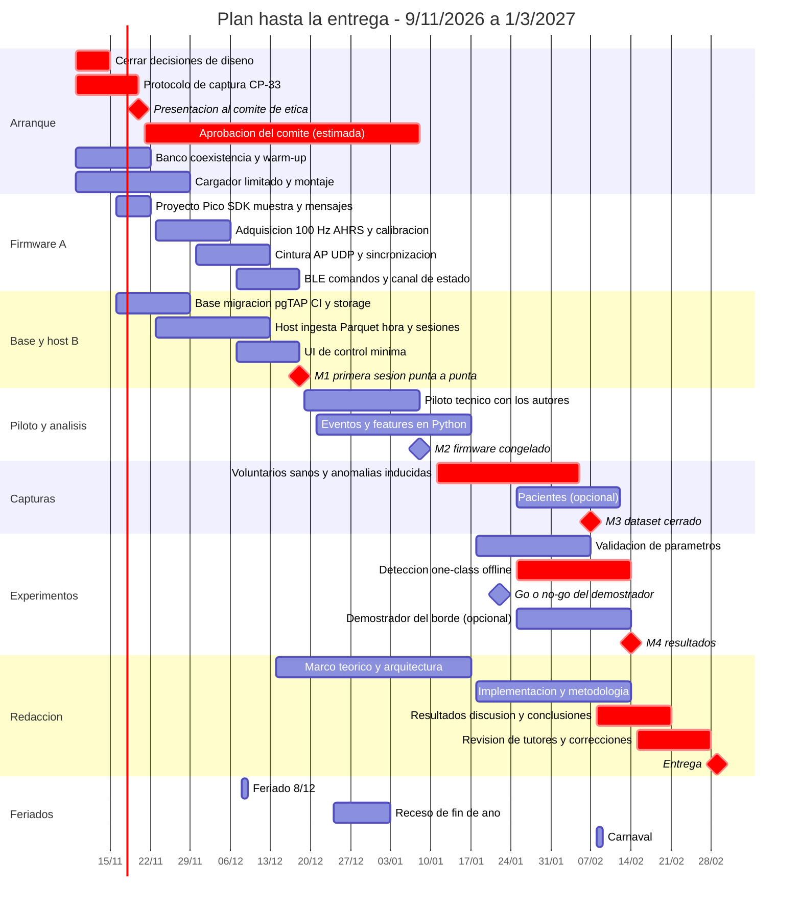

# Cronograma y plan de trabajo hasta la entrega

> **Estado:** propuesta del 2026-11-08, pendiente del OK de Juan y Tobías. **Fecha de entrega fijada por Juan: 1 de marzo de 2027.**
>
> **Qué es.** El calendario de lo que falta hacer, con el alcance que entra hasta la entrega. Reemplaza el cronograma del anteproyecto (§7: seis fases entre abril y noviembre de 2026), que queda como registro histórico, igual que el resto del anteproyecto (ADR-030). Es también el roadmap de implementación por fases que estaba pendiente.
>
> **Cómo se mantiene.** Es la fuente única del calendario: las fechas y el alcance se cambian acá y en ningún otro lado. Al cumplir un hito se marca en la §7; cada cambio de fechas o de alcance se registra en `memoria/changelog.md`.

## 1. Por qué se reprograma

El anteproyecto planificaba así, y así está cada fase al 8/11/2026:

| Fase del anteproyecto | Plan original | Estado al 8/11/2026 |
|---|---|---|
| I — Anteproyecto y fundamentación | abr–may | **Hecha**: anteproyecto presentado, marco teórico (documento de trabajo), 22 papers |
| II — Diseño y desarrollo del hardware | may–jun | **En parte**: prototipos de banco y esquema de alimentación; falta montarlo en el calzado |
| *Diseño de arquitectura* (no figuraba como fase) | — | **Hecha** (16/7 → 8/11): 4 vistas, ADR-000 a 056, SPEC-01 a 11, esquema de la base y contratos de interfaz |
| III — Desarrollo del software | jun–ago | **Sin empezar** (la base está diseñada, no creada) |
| IV — Integración y pruebas de sistema | ago | Pendiente |
| V — Testeo, validación y análisis | ago–sep | Pendiente |
| VI — Finalización (estadística, tesis y defensa) | sep–nov | Pendiente |

El diseño llevó más que lo previsto, pero deja resueltas casi todas las decisiones: lo que sigue es construir, capturar, analizar y escribir. Quedan **16 semanas** (del 9/11/2026 al 28/2/2027), con feriados (8/12, 25/12, 1/1, Carnaval 8–9/2) y el verano en el medio.

## 2. Qué está hecho

- **Fundamentos:** anteproyecto presentado; marco teórico como documento de trabajo (~17.700 palabras); notas de 22 papers; catálogo de features con su evidencia; informe de alineación.
- **Arquitectura completa:** 4 vistas consolidadas, 56 decisiones con sus opciones y su porqué (bitácora), 11 specs de algoritmos de firmware, esquema de la base diseñado (Postgres 17, series particionadas, RLS) y los contratos entre programas (mensajes, BLE, OTA, artefactos, catálogo, crudo y hora).
- **Hardware en banco:** tres Pico 2 W con MPU-6050; las plantillas con 2 FSR (punta y talón) y motor vibrador; alimentación rediseñada (celda → VSYS).
- **Revisión previa a implementar** (17/10) y corrección de las contradicciones entre documentos (8/11).

## 3. Qué falta

- **Decisiones de diseño de la revisión del 17/10.** Estado al 8/11:
  1. Cómo arranca la primera sesión de un paciente que todavía no tiene modelo → **decidida** (ADR-057).
  2. Cuándo y con qué se fijan los umbrales del detector de pasos de cada persona → **abierta, con propuesta** (CP-35).
  3. FSR en cuentas o en fuerza → **decidida: cuentas, sin curva por ahora** (ADR-058).
  4. Tres arreglos del esquema: alta de pacientes, a qué modelo apunta el feedback y el vínculo sesión ↔ modelo → **decididos** (ADR-059).
  5. Dónde se guarda el canal de estado → **decidida: tabla `device_status`** (ADR-059).
  6. Sincronización: guardar los beacons y apagar el ahorro de energía del WiFi → **decididos** (ADR-061); dónde se toma la hora del beacon queda para la implementación (CP-28).
  7. Mahalanobis → **decidida: calibración de ~200 zancadas por pie** (ADR-060); el método del umbral, **abierto** (CP-37).
  8. La regla para emparejar una zancada izquierda con una derecha → **abierta, con propuesta** (CP-36).
  9. Cómo se corren los tests C↔Python fuera del micro → **abierta, sólo para el demostrador** (CP-38).
  10. Que el provisioning acepte más de un modelo → **decidida** (ADR-059).
  11. Cómo se alinea el equipo con el MoCap → **diferida**: hoy no hay acceso al MoCap del ITBA (CP-33).
- **Trámites:** protocolo de captura y validación (CP-33) y su presentación al comité de ética (CP-18), que es la compuerta de toda captura con personas.
- **Hardware:** cargar las celdas con un cargador limitado a ≤500 mA (el módulo actual entrega 2,4 A y la celda admite 500 mA); resolver dónde va la batería de la plantilla (la 102050 no entra bajo el pie) y cómo se fijan las plantillas y la cintura.
- **Pruebas de banco:** la coexistencia WiFi-AP + BLE al caudal de captura (~11,7 KB/s) y el tiempo de estabilización del IMU (CP-25).
- **Firmware de captura:** adquisición a 100 Hz, AHRS y calibración, AP WiFi, sincronización, enlace BLE, comandos de sesión y canal de estado.
- **Base y host:** crear la base como migraciones (con los arreglos del punto 4), tests y CI; el host que recibe por BLE, escribe el crudo en Parquet, traduce la hora a UTC y abre/cierra sesiones; una UI de control mínima.
- **Análisis offline (worker):** detección de eventos y cálculo de features en Python desde el crudo; validación contra una referencia, si se consigue; modelos one-class personalizados.
- **Capturas:** piloto técnico, voluntarios sanos con anomalías inducidas (con referencia, si se consigue); pacientes, si se puede (§4). La calibración de cada sujeto lleva ~200 zancadas por pie (ADR-060).
- **Redacción de la tesis.**

## 4. Alcance hasta el 1/3 (a confirmar)

**Entra todo lo que el anteproyecto llama objetivos de mínima** (§5.2), que son el compromiso formal de la tesis:

| Objetivo de mínima del anteproyecto | Cómo se cubre |
|---|---|
| 1. Calzado que mide la marcha y transmite a una computadora cercana | Firmware de captura + host + base |
| 2. Protocolo de calibración validado con estándares clínicos (ground truth) | Protocolo (CP-33) + validación contra una referencia (ICC, Bland-Altman). **Hoy no hay acceso al MoCap del ITBA** (8/11): con qué se valida queda abierto en CP-33 |
| 3. Software que recibe, almacena y procesa | Host + base + worker offline |
| 4. Experimentos de detección de anomalías | Features off-device + modelos one-class personalizados (Mahalanobis, Isolation Forest, autoencoder denso, OC-SVM de referencia) evaluados con anomalías inducidas |

**Objetivo extendido (opcional): un demostrador del borde.** El título promete "aprendizaje automático en el borde y biofeedback háptico". Si el 22/1 el núcleo va en fecha, se arma una demostración de concepto: unas pocas features calculadas en las plantillas, Mahalanobis en la cintura (no necesita TFLite Micro, así que no depende de CP-21) y una alerta vibrotáctil simple. Si no llega, queda como trabajo futuro sin afectar los objetivos de mínima.

**Pacientes (opcional):** el núcleo del dataset son voluntarios sanos con anomalías inducidas. Una captura con pacientes entra sólo si el comité y una institución lo habilitan a tiempo.

**Queda como trabajo futuro** (diseñado y documentado, no implementado antes del 1/3): OTA de firmware y de modelos (no se sella ninguna plantilla; se programan por USB), adaptación online y la comparación con/sin adaptación (ADR-043), modo edge completo con snippets, las features del micro para todo el catálogo con sus tests de paridad, la revisión del PCB (4 FSR con mux, traza INT, cargador), los bloques E e I en el micro, el gesto de emparejamiento y el multi-host, el dashboard, la app móvil y el worker en la nube. El emparejamiento básico con passkey sí entra, porque cifra datos de salud.

## 5. Calendario por fases

Las dos líneas de desarrollo (A: firmware; B: base y host) pueden repartirse entre Juan y Tobías; si una se atrasa, la otra ayuda. El host se puede programar contra un simulador de la cintura en Python, con los mismos mensajes, para no depender del firmware.

| Fase | Fechas | Qué se hace | Termina con |
|---|---|---|---|
| **0 — Arranque** | 9/11 → 22/11 | Cerrar las decisiones que quedan (CP-35 a CP-37) · protocolo de captura (CP-33) · presentarlo al comité (20/11) · gestionar el acceso al MoCap (hoy no hay) o definir otra referencia · banco: coexistencia y estabilización del IMU · cargador limitado · montaje en el calzado | Protocolo presentado y decisiones cerradas |
| **1 — Software para capturar** | 16/11 → 18/12 | **A:** proyecto del Pico SDK, formato de muestra y `mensajes.proto` → adquisición 100 Hz + AHRS + calibración → cintura con AP, UDP y sincronización → BLE, comandos y canal de estado. **B:** base (migración, pgTAP, CI, storage) → host (ingesta, Parquet, hora UTC, sesiones) → UI mínima | **M1 (18/12):** primera sesión de 30 min punta a punta en banco |
| **2 — Piloto y análisis offline** | 19/12 → 10/1 | Piloto técnico con los autores: fijar `β` de Madgwick, revisar caudal, pérdidas, autonomía y postura de calibración (CP-31) · eventos y features en Python · empieza la redacción (marco teórico y arquitectura) · receso 24/12 → 3/1 | **M2 (8/1):** firmware congelado para las capturas |
| **3 — Capturas** | 11/1 → 7/2 | Voluntarios sanos: caminata supervisada, calibración de cada sujeto (~200 zancadas por pie, en tandas) y anomalías inducidas; con referencia si se consiguió · pacientes, si se habilita · **requiere la aprobación del comité** | **M3 (7/2):** dataset cerrado |
| **4 — Análisis y experimentos** | 18/1 → 14/2 | Validación de eventos y parámetros contra la referencia, si la hay (ICC, Bland-Altman) · selección de features (#12) · detección one-class offline · demostrador del borde si hubo luz verde el 22/1 | **M4 (14/2):** resultados |
| **5 — Redacción y cierre** | 14/12 → 28/2 | Marco teórico y arquitectura (dic–ene) · implementación y metodología (ene–feb) · resultados, discusión y conclusiones (8/2 → 21/2) · revisión de los tutores y correcciones (15/2 → 28/2) | **Entrega (1/3/2027)** |

## 6. Diagrama de Gantt

**El proyecto completo** (las fechas de la primera barra son aproximadas):

**El detalle hasta la entrega** (en rojo, el camino crítico):

## 7. Hitos

| Fecha | Hito | Si no se cumple |
|---|---|---|
| 20/11 | Protocolo listo y presentado al comité | Todo lo que sigue con personas se corre: es lo primero a defender |
| 22/11 | Decisiones que quedan (CP-35 a CP-37) cerradas; resultado de la prueba de coexistencia | Si la coexistencia no sostiene el caudal, se decide cómo bajarlo antes de seguir con el BLE |
| 18/12 | **M1** — primera sesión punta a punta en banco | Se usa la primera semana de enero; el piloto se acorta |
| 8/1 | **M2** — firmware congelado para capturas; aprobación del comité (esperada) | Sin aprobación, se replanifican las capturas con el plazo que dé el comité |
| 22/1 | Go o no-go del demostrador del borde | No-go: queda como trabajo futuro |
| 7/2 | **M3** — dataset cerrado | Se achica la muestra; los experimentos usan lo capturado |
| 14/2 | **M4** — resultados | Se recorta el análisis a lo que alcanza para los objetivos de mínima |
| 1/3 | **Entrega** | — |

## 8. Riesgos del calendario

| Riesgo | Qué se hace |
|---|---|
| El comité de ética tarda más de lo estimado | Presentar el 20/11 y preguntar el plazo; dejar todo listo para capturar el día de la aprobación; si llega tarde, menos sujetos y foco en anomalías inducidas. Consultar si el piloto técnico con los propios autores requiere aprobación |
| **No hay acceso al MoCap del ITBA** (8/11), y el objetivo de mínima 2 pide validar contra una referencia | Gestionar el acceso; mientras tanto, definir en CP-33 una referencia alternativa más simple —por ejemplo, video de alta velocidad del celular (240 fps) anotado a mano para los eventos, o el tiempo en 10 m medido con cronómetro—, con su menor precisión declarada |
| La coexistencia WiFi-AP + BLE no sostiene el caudal de captura | Se prueba en la fase 0, antes de construir encima |
| El firmware se atrasa | El demostrador del borde es lo primero que se cae; el host avanza contra el simulador |
| Batería y montaje de la plantilla sin resolver | Se resuelve en la fase 0: sin eso no hay captura con personas |
| Feriados, receso y disponibilidad de dos personas | Están descontados en las fechas; el camino crítico tiene poco margen, así que conviene revisar el avance cada semana |

## 9. Referencias

Anteproyecto (`docs/Anteproyecto_Tesis.pdf`, §5 objetivos y §7 planificación original) · `docs/cuestiones_pendientes.md` (CP-18, CP-21, CP-25, CP-31, CP-33, CP-35 a CP-38) · ADR-057 a ADR-061 (decisiones del 8/11) · `docs/arquitectura/esquema_alimentacion.md` §7 (hardware) · Vista 4 §1.7 (crear la base) · ADR-030 (el anteproyecto queda como registro) · ADR-043 y ADR-052 (lo que queda como trabajo futuro).
